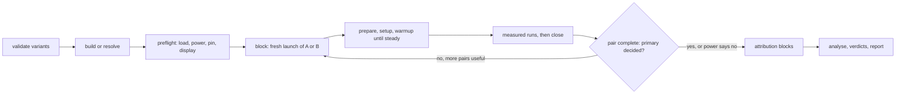
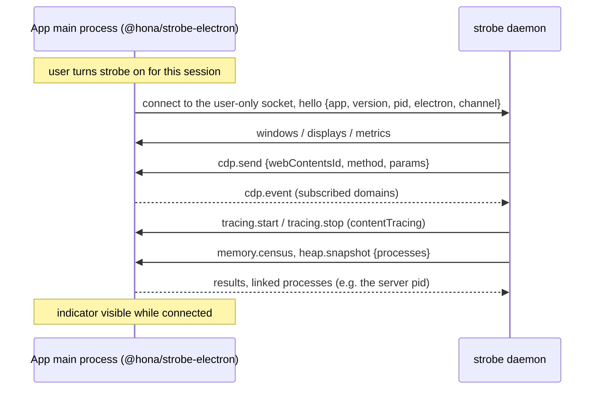

# strobe — spec

`strobe` measures and explains performance: a web page, an Electron app (installed or packaged,
launched in isolation from an app profile), a Bun or Node process, or any process by PID. It records
everything on one clock, refuses measurements it cannot defend, and gives people and agents a
verdict plus handles to drill into.

This file is the source of truth. If an implementation idea conflicts with it, stop and ask.
When a design change is agreed, update this file in the same change.

---

## 1. Rules (non-negotiable)

1. **Valid or nothing.** A number strobe cannot defend is not printed. Validators refuse a run
   (exit 4, §10.1); analysers warn next to the number (§10.2). Every number carries its unit,
   `n`, interval or `exact`, method, probe set, build and device.
2. **Measure the app, not strobe.** Low overhead first: no helper process where an OS API or a
   file read works; no polling where an event exists; budgets in §19 hold. strobe's own CPU, GPU
   and memory are a track in every recording.
3. **Timing and attribution never share a block.** Profilers, heap snapshots, allocation
   sampling, coverage, counters and instrumented builds change timing. They run in attribution
   blocks only (§8.1). A recording that mixes them is marked `mixed`, and its timing metrics
   are labelled `perturbed`.
4. **One primary metric per experiment**, declared before the run. Secondary metrics get a
   verdict only through the gate in §9.3; otherwise they are descriptive.
5. **No automated tests. Ever.** No unit, integration, e2e or snapshot tests, no test files, no
   test dependencies, no test steps in CI. Verification is the calibration page and A/A runs on
   real devices (§10.3, §10.4). CI only builds release binaries.
6. **Early iteration speed beats everything else.** Smallest change that works. No speculative
   abstraction.
7. **One concept, one name.** Each MCP tool is exactly a CLI command: same name, same
   arguments, same JSON as `--json`.
8. **Raw, general tools.** Five MCP tools (§17). New questions become views or arguments, not
   new tools.
9. **Local only.** Recordings never leave the machine unless the user copies them. Traces and
   heap snapshots can hold prompts, file contents and credentials: they are written owner-only,
   reports and MCP results carry aggregates, and string contents appear only with `--reveal`.
10. **Never break user space.** strobe writes only its own files and marked managed entries, all
    removed by `strobe leave`. It never changes a target's settings, profile or data. Launched
    targets get isolated homes; attached targets are left as they were on detach.
11. **One-time setup does every privileged step.** `strobe up` asks for the one UAC or sudo it
    needs. After that nothing prompts; `status` only reports problems.
12. **Rust stable, pragmatic dependencies.** Well-known crates are fine. Each dependency has a
    one-line reason in `Cargo.toml`. The budgets in §19 decide, not taste. No crate that needs a
    C compiler: every device builds with the plain Rust toolchain (adais has no C toolchain).
    One-time downloads shell out to `curl` (built into Windows 10+, macOS and Linux) instead of
    linking TLS.
13. **No backwards compatibility while pre-1.0.** Breaking changes are fine. No migration code.
14. **Normal speed only.** strobe never slows the target: no CPU throttling, no network
    throttling, no frame-rate caps in timing blocks. CPU throttling slows only the renderer's
    main thread, so the bottleneck moves where no real device has it. Small effects are found
    with more pairs, stress comes from bigger workloads (`params`), and slow hardware is measured
    on slow hardware (`--on`). The `Throttled` validator (§10.1) catches a slowed target from any
    cause.
15. **Generic: strobe knows no product it measures.** Apps under test are consumers. What one of
    them needs (its install path, env vars, seed files, the user state to guard, URL schemes it
    registers, how to build and serve it, its mocks and benches) lives in that app's own repo:
    `strobe.json` (`apps`, `build`, `serve`) and its bench files. Strobe has mechanisms, never a
    product's names. The only product-specific code is on the using side: registering strobe's
    MCP and skill with the agent harness that drives it (§5.3), as mesh does.

## 2. Invariants

- Windows 10+, macOS 13+, or Linux (glibc or musl), x64 or arm64.
- `gh` installed and authenticated (install and update, like mesh).
- `opencode` installed for MCP and skill registration. Not needed to measure.
- Chromium targets: an installed Chrome, Edge or Chromium, or Playwright's Chromium. strobe finds
  one; it never downloads a browser.
- Deep mode (§13.4): one UAC (Windows) or one sudo (Linux) during `up`.

Tools may be installed but not on PATH (desktop-app shells). strobe looks in known install
locations, not only PATH.

## 3. Glossary

| Term | Meaning |
|---|---|
| target | What is measured (§5.1) |
| probe | One source of data: trace categories, CPU sampler, OS sampler, heap census, … (§8.1) |
| probe set | Named group of probes: `timing`, `attribution`, `memory`, `deep` |
| recording | Everything one capture produced, addressed by a handle `rec_…` |
| experiment | One `bench` invocation, addressed by `exp_…` |
| variant | One side of an experiment: a git ref, a directory, an installed app |
| bench file | A `.bench.ts` file: targets, params, setup and cases (§9.6) |
| case | One entry in a bench file's `cases`, with its `run` function |
| series | One case × target × params combination: the unit that gets a verdict |
| run | One call of a case's `run` (BenchmarkDotNet's iteration) |
| phase | A named span inside a run, such as `down` |
| block | One fresh launch of one variant: prepare, setup, warmup runs, measured runs, close |
| pair | Two adjacent blocks of different variants; order alternates A B, B A |
| timing / attribution block | A block with the `timing` probe set, or with profilers (§8.1) |
| primary | The metric the experiment is about, declared before the run |
| verdict | `faster`/`slower` (or `less`/`more`, `fewer`/`more`), `same`, `unclear`, `underpowered`, `refused` |
| validator | A check that refuses a run (§10.1) |
| analyser | A check that warns in the result (§10.2) |
| census | A consistent per-process memory account at one moment (§8.6) |
| bridge | `@hona/strobe-electron` inside an app's main process (§13.2) |
| accessibility tree | what an app exposes to the OS's assistive technology (UI Automation on Windows, the AX API on macOS, AT-SPI on Linux): strobe finds and waits on a native app's elements through it (§13.7) |
| calibration | The known-cost page every probe must recover (§10.3) |
| A/A | An experiment with the same build on both sides (§10.4) |

## 4. Repo and files

### 4.1 Tool repo — `Hona/strobe` (private for now)

```
Cargo.toml  build.rs
src/            one package: lib + bins strobe, strobew (Windows windowless); §4.3
viewer/         self-contained HTML report viewer (`viewer/report.html`), embedded
calibration/    the known-cost page (static), embedded
sdk/            TypeScript: @hona/strobe (the CLI launcher and bench SDK), @hona/strobe-web, @hona/strobe-electron, @hona/strobe-playwright
                (one Bun workspace)
skill/SKILL.md  the built-in skill, embedded (include_str!)
schema/         strobe.v1.json (project config), result.v1.json, bridge.v1.json
install.sh  install.ps1
.github/workflows/release.yml   build + release only, no tests
SPEC.md  AGENTS.md  README.md
```

### 4.2 Local state (per device, never in a repo)

State dir: `~/.local/share/strobe/` (respect `XDG_DATA_HOME`) on Linux and macOS;
`%LOCALAPPDATA%\strobe\` on Windows. Created `0700` / user-only ACL.

```
state.json          { "mcp_port", "helper", "engine", "last_calibration" }
mcp-token           MCP bearer token, user-only
experiments/<exp>/  result.json per experiment; index.jsonl lists them (§14.2)
recordings/<rec>/   §14.1
builds/<key>/       variant build cache (§9.5)
symbols/            source maps by debug ID, PDB cache
engine/<version>/   trace_processor (§15), sha256-checked
run/  log/          temp files; daemon.log, helper.log (rotated at 1 MB)
daemon-<build>.sock Linux/macOS daemon socket (Windows: named pipe, §16)
```

Installed binary: `~/.local/bin/strobe` (Linux/macOS); `%LOCALAPPDATA%\Programs\strobe\{strobe,strobew}.exe`
(Windows, on user PATH). The deep-mode helper lives where only an elevated step can write
(§13.4).

**macOS signing.** macOS keeps a privacy grant (Accessibility, called Device Control and Data Access
on macOS 27, and Screen Recording) for a binary's designated requirement. An ad-hoc signature's
requirement is its hash, which every release changes, so each update silently dropped the grants.
The Release workflow signs each macOS binary with a Developer ID Application certificate under the
hardened runtime (`packaging/macos/strobe.entitlements`: no exceptions), identifier
`dev.hona.strobe`, and notarizes it (`scripts/macos-sign.sh`), so the requirement is the identifier
and team and the grants survive updates. It needs five repository secrets: `MACOS_CERTIFICATE_P12`
(the certificate with its private key as a `.p12`, base64), `MACOS_CERTIFICATE_PASSWORD`,
`MACOS_NOTARY_KEY_P8` (an App Store Connect API key's `.p8` contents), `MACOS_NOTARY_KEY_ID` and
`MACOS_NOTARY_ISSUER_ID`. Without them the binaries ship ad-hoc signed and a tag build warns. A bare
executable cannot carry a stapled ticket: Gatekeeper looks it up online at its first run.

**Inherited and own grants.** macOS attributes a process's permissions to its responsible process.
On macOS 27 a child of a launchd daemon (a remote shell's, such as mesh) is AX-trusted through the
daemon, but Screen Recording is checked against the child's own binary: ScreenCaptureKit answered
-3801 ("user declined TCCs") with the daemon granted. `strobe status` says whose grant each
permission is (inherited from the process it names, or strobe's own) and, for that split, names
strobe's own executable (symlinks resolved) as the one to add in Screen & System Audio Recording.

### 4.3 Architecture (`src/`)

```
lib.rs          module declarations only
main.rs         bin `strobe`: parse args → app → exit code
bin/strobew.rs  Windows windowless build (daemon autostart)
cli/            argument parsing, help, text + JSON rendering
app/            commands (up, status, record, bench, query, report, top, update, leave, daemon)
model/          plain data: Target, Probe, Recording, Run, Metric, Verdict, Env, Validity
target/         finding and driving targets → chromium.rs (CDP), bridge.rs, inspector.rs,
                process.rs, isolate.rs (isolated launches), electron.rs, native.rs (native apps,
                §13.7), a11y/ (the OS accessibility client: uia.rs, ax.rs, atspi.rs; input:
                input.rs (posted messages), cg_input.rs (Quartz), xtest.rs; keys.rs shared)
driver/         the bench file's `page`: over CDP, or a native app's accessibility tree and
                message loop (native.rs)
probe/          collecting → trace.rs, cpu.rs, alloc.rs, heap.rs, symbols.rs (source maps),
                census.rs, coverage.rs, os/{windows,linux,macos}.rs, gpu/{pdh,nvml,d3dkmt,drm,ioreport}.rs,
                helper.rs
heapsnap.rs     V8 heap snapshots: streaming parse, dominators, classes, retainer paths, diff, leaks
metrics.rs      a block's trace → metric values
engine/         trace_processor: the only place that runs it (§15)
store/          experiments/ and recordings/: the only place that writes them (§14)
runner/         the bench runner link: spawns `bun`, speaks the runner protocol (§9.6)
stats/          paired tests, intervals, modes, power, multiplicity (§9.3)
validity/       validators, analysers, calibration, A/A (§10)
symbol/         source maps, packages, owners, PDBs (§12)
report/         views → text, JSON, markdown, HTML (§11)
mcp/            MCP server: Streamable HTTP for the daemon, stdio (hidden)
host/           paths, processes, sockets, autostart, opencode registration, mesh
ui/             embedded viewer and calibration assets
```

- `cli`, `mcp` → `app` → everything else. Backends (`target`, `probe`, `engine`, `store`,
  `symbol`) depend only on `model` (and `host` for paths), never on `app`/`cli` or on each
  other's internals. They return `model` types.
- One backend each until a second exists. No traits or plugin layers ahead of need.
- Idiomatic Rust: `pub(crate)` by default, `cargo fmt`, `cargo clippy` clean.

## 5. CLI

```
strobe <command> [flags]

Setup      up · update · leave
Use        status · record · bench · query · report · top
Internal   daemon · mcp · helper (hidden)
Global     --json  -q/--quiet  -v/--verbose  -h/--help  -V/--version
```

### 5.1 Targets

| Syntax | Meaning |
|---|---|
| `https://…`, `http://…` | a page in a strobe-launched Chromium: isolated profile, real GPU, fixed window (§13.1) |
| `cdp:<port>`, `cdp:ws://…` | a running CDP endpoint (Playwright's, a dev Electron's) |
| `app:<id>` | an app by its profile in strobe.json `apps`: an Electron app (§13.2) launched in an isolated home, or attached through its bridge (§13.3); a profile with `kind: "native"` is a native app (§13.7) |
| `exe:<path>` | launch a packaged Electron app in an isolated home; `--app <id>` borrows a profile for another build of that app; `--native` launches any executable as a native app (§13.7) |
| `node:<port>`, `bun:<port>` | an inspector endpoint (§13.5) |
| `pid:<n>`, `proc:<name>` | outside-in only: OS, GPU, OS present events, deep (§13.6). `proc:` takes the one process of that name whose parent is not of that name |
| `file:<path>` | import an existing capture: a Chrome trace, `.cpuprofile`, `.heapsnapshot`, or a folder of them with a `manifest.json` (§8.7) |
| `<target>@<device>` | run on a mesh device through `mesh exec`; results come back tagged with the device |

### 5.2 Exit codes

| Code | Meaning |
|---|---|
| 0 | success; for `bench`, a verdict was reached |
| 1 | general error |
| 2 | usage error |
| 3 | needs a human (UAC, consent in the app); the exact step is printed |
| 4 | refused: a validator failed; the result names it and the fix |
| 5 | inconclusive (`unclear` or `underpowered`), only with `--require-verdict` |
| 124 | timeout |
| 130 | `bench` stopped (Ctrl-C, SIGINT, SIGTERM or `--stop`): what finished is written, `--resume` goes on |
| 255 | target or device unreachable |

### 5.3 `strobe up`

Idempotent; re-running is the repair command.

```
strobe up [--yes] [--check] [--skip <step,...>]
```

Steps (each checks first, prints ✓ / ! / ✗):

1. **Preflight** — OS, CPU and topology (CCDs, V-Cache by L3 size, P/E cores), power plan,
   GPUs (adapters, NVML), displays and refresh rates, `opencode`, browsers, installed apps.
2. **Engine** — download the pinned trace_processor (§15), verify sha256.
3. **Helper** — deep mode (§13.4): one UAC or sudo. Skippable (`--skip deep`). On Windows the one
   elevated step adds the user to Performance Log Users (present events in strobe's own process from
   the next logon) and installs the helper (present events until then, and native stacks).
4. **Daemon** — autostart registered, this build's daemon running (§16).
5. **MCP** — register `strobe` in opencode's global config and make it live in every loaded
   location, exactly as mesh does (`opencode mcp add`, then `opencode api experimental.mcp.add`),
   with the token read from `{file:<state>/mcp-token}`.
6. **Skill** — write `~/.config/opencode/skills/strobe/SKILL.md` (strobe-owned folder, §18).
7. **Calibrate** — the quick calibration (§10.3) in a strobe-launched Chromium.

```
$ strobe up
strobe up · adais
  ✓ cpu        Ryzen 9 9950X3D · 16C/32T · CCD0 V-Cache (96 MB L3), CCD1 (32 MB L3)
  i power      Balanced (benches and timed recordings switch to High performance for the run, then back)
  ✓ gpu        RTX 5070 Ti · NVML ok · D3DKMT ok
  ✓ displays   2 · 144 Hz, 60 Hz
  ✓ targets    Chrome · 2 app profiles installed
  ✓ engine     trace_processor <version> · sha256 ok
  ! helper     deep mode needs admin: approve the UAC prompt
  ✓ daemon     running · starts at login
  ✓ mcp        registered "strobe" · live in 6 opencode locations
  ✓ skill      ~/.config/opencode/skills/strobe/SKILL.md
  ✓ calibrate  busy, alloc, idle within tolerance
```

### 5.4 `strobe status`

```
strobe status [<target>] [--calibrate] [--json]
```

Reports: environment (§9.4 provenance fields), a validity preflight (idle load per core for
3 s, power plan, battery, throttling, displays and the adapter driving each), daemon, helper,
engine, attachable targets (running apps and their bridge state, CDP endpoints found through
`DevToolsActivePort` files, installed apps), recordings disk use, last calibration.
`--calibrate` runs the full calibration (§10.3).

### 5.5 `strobe record`

```
strobe record <target> [--probes <set|list>] [--for <duration> | --bench <file>#<case>]
                       [--ring <duration>] [--pin] [--name <text>] [--json]
```

- One recording; returns its handle, validity and a summary.
- Default probe set: `timing`. `--probes attribution,memory` and friends per §8.1.
- `--for` records for a duration; neither it nor `--bench`: until Enter (CLI) or `timeout` (MCP).
- `--bench <file>#<case>` records a bench case (a case glob matches) on `--head` (default `.`),
  so a flow behind clicks or keys records as easily as a URL. It runs as `bench --check --why
  always`: setup, warmup until steady, then the measured runs under the attribution probes; it
  prints the recording handle per matching series. No `<target>` is needed: the bench file names it.
- `--ring 30s` starts a flight recorder in the daemon (a ring buffer of the last 30 s, timing
  probes only) and returns its id; `strobe record ring:<id>` dumps it into a recording.
- `file:<path>` imports (§8.7).
- A native app (`app:<id>` with a native profile, or `exe:<path> --native`) records one run from
  outside after a 3 s settle: CPU, thread wakes, IO, GPU, memory, the UI thread (`ui.cpu`,
  `ui.wakes`) and OS present events (§13.7). `--probes attribution` adds native stacks (§13.4).
  `--until-line <regex>` starts the recording when the app prints a matching line (stdout or stderr)
  instead of after the fixed settle, within 120 s; `--stop-line <regex>` ends it at one (`--for`
  caps it, else 10 minutes). A program that prints its states (`device released`) records each state
  without sleeps in the program or a script polling its output.
- `strobe run [--pin …] [--reserve-cpus on|off] [--power high|keep] -- <command> [args…]` runs an
  ad-hoc harness under a bench block's conditions: it takes the device's bench slot (so it never
  overlaps a timed block), switches to the fastest power plan, pins the command to the target's CPUs
  (`--pin auto`: the V-Cache CCD) and keeps this user's other processes off them (Windows, §9.4),
  and puts everything back when it exits; its exit code is strobe's. It measures nothing itself: the
  harness prints its own numbers. A harness timed the same build at 190 ms and 250–330 ms an hour
  later while other agents kept 60% of the CPUs busy; strobe's reservation covered only its benches.

### 5.6 `strobe bench`

```
strobe bench <file.bench.ts> --head <variant> [--base <variant>]
             [--filter <cases>] [--target <name>] [--params <k=v,...|all>]
             [--primary <metric>] [--equivalence <pct>] [--pairs auto|<n>] [--runs <n>]
             [--probes <set>] [--repeat <n>] [--pin auto|none|ccd0|ccd1|<cpus>] [--aa] [--check]
             [--bisect <good>..<bad>] [--on <devices>] [--max-time <duration>]
             [--why auto|always|never] [--trace lean|full] [--power high|keep]
             [--reserve-cpus auto|on|off] [--require-verdict] [--json]
strobe bench --stop <exp>
strobe bench --resume <exp>
```

**Stopping and resuming.** Ctrl-C (SIGINT), SIGTERM or `strobe bench --stop <exp>` (from any shell,
or for a bench the daemon runs) stops a bench once its current block ends; waits (a locked session,
the bench slot, busy CPUs) end at once. A second Ctrl-C ends strobe at once. On Windows and in a
terminal the runner and the browser get the same Ctrl-C and end with it, so the block in flight is
dropped. What finished stays: the half pair goes, the finished pairs of the running series get
their comparison (no verdict unless a planned look had decided it), finished series keep theirs,
and the rest are listed as not run. The result (`result.json`, `report`, `--format pr`, which marks
it incomplete) is written and strobe exits 130. A failure after some pairs (a refused block, a
launch that kept failing) ends the same way, with that error's exit code. After every pair a bench
saves its command line and each series' finished blocks and pairs, or its result once done, in the
experiment's `state.json`; `--resume <exp>` runs the same command line again (the bench file and
directory variants as full paths, so from any folder) from there: finished series are kept, the
running one goes on from its next pair, and variants build again (unchanged ones from the cache).

**Launches that fail and pass.** A block whose launch failed for a reason that passes (the browser
did not open its debugging port, a DevTools call such as `Target.attachToTarget` got no reply, the
connection dropped) runs again, after 30 s and a wait for quiet CPUs, holding nothing meanwhile, up
to 3 times per block; a run that failed, or a validator, still ends it. Two such failures under load
(load average 35–70 on a shared Mac) once lost a 40-minute experiment with its finished pairs.

Every series in the file (case × target × params, narrowed by `--filter`, `--target` and
`--params`) gets its own verdict. `--filter` takes case names separated by commas; each is exact
unless it holds `*`, a glob over the whole name: `--filter window-closed` runs only that case,
`--filter "window-closed*"` also `window-closed-memory`. Before anything builds, strobe prints
the cases the filter runs and skips, and for an exact name that other cases start with, the glob
that would take them too; a filter that matches nothing is a usage error that lists the cases.
With `--base`: the A/B pipeline in §9. Without it: `--aa`
runs `--head` against itself (§10.4), `--probes memory --repeat <n>` is a leak run (§8.6), and
`--check` validates the file: one block per series on `--head`, one run per case, no warmup and
no statistics. Each case passes, with its declared metrics' values from that run, or fails with
the refusal, the page's URL and its screenshot; the next case still runs, and any failure exits 1.
A failure keeps the fix strobe's driver gave (a missing permission and where to grant it) and
names the hook once (`setup: …`, not `setup: setup: …`). Under each case, `--check` prints the
last 10 lines the bench file's hooks wrote to the console during it (`console.log`/`error`; the
rest stay in the experiment's `runner.log`, whose path it names). Each passing case keeps its
block's recording and prints it (`rec  rec_… · strobe query rec_… threads`), and `query <exp> <view>`
on a check of one case answers from that recording (with several, it lists them).
`--check --why always` also runs one attribution block per passing series on `--head` (warmed as in
a bench, then `--runs` measured runs, default 5; views name the warmup runs the trace also holds)
and prints its recording, to profile one build before there is anything to compare.
`--head` alone is an error that suggests `--base` or `--check`. `--runs` is the measured runs per
block (default 5). `--params all` adds the `more` values of every parameter (§9.6). Variants are
described in §9.5. `--bisect` walks a commit range (§9.7). `--on` runs on mesh devices (§9.8).

Text output (a full example):

```
strobe bench timeline.bench.ts · scroll · desktop · turns=200   base origin/dev@8b4d98c   head lazy-tooltip@98acaa3
env    Windows 11 26100 · Ryzen 9 9950X3D 16C/32T · RTX 5070 Ti
       app:desktop (isolated launch) · window 1600×1000 @1.5x · display 144 Hz
plan   pinned CCD0 (V-Cache) · power plan High performance (restored) · visible, unoccluded
blocks 8 pairs (16 fresh launches) · warmup until steady · 5 runs per block · stopped: primary decided
probes timing: frames, toplevel threads, os, gpu · overhead 0.6% main thread

metric                         base       head       Δ        95% CI           verdict
★ frames.presented.p95         10.4 ms    9.6 ms     −7.7%    −11.0 … −4.2     faster
  frames.dropped               41         33         −8       −14 … −2         fewer
  main.script.self             412 ms     362 ms     −12%     −15 … −9         faster
  alloc.bytes   exact (A/A)    160 MB     115 MB     −28%     exact            less
  gpu.process.private          302 MB     301 MB     −0.3%    −1.2 … +0.6      same (±2%)
  frames.presented.p99.5       —          —                                    refused: 1,310 frames < 2,000

★ primary, declared before the run · secondaries gated on the primary, Holm-corrected

warnings
! MultimodalDistribution  main.script.self: 2 modes (mValue 3.4) before pinning; pinned run is unimodal
! Background              block 5: MsMpEng.exe 31% on CPU 28–29 for 320 ms; block kept, flagged
i Attribution             separate blocks: hotspots, allocation sites, counters → rec_91c0
```

### 5.7 `strobe query`

```
strobe query <handle | a..b | exp_…> <view> [view arguments] [--top <n>] [--max-bytes <n>] [--json]
strobe query <handle> sql "<query>"
```

Views in §11.1. `a..b` compares two recordings. `exp_…` reads an experiment, including one
still running (`progress`).

### 5.8 `strobe report`

```
strobe report <view> <handle | exp_…>… [--format md|html|pr] [--out <path>] [--open] [--json]
```

Writes a self-contained artifact from a view in the catalog (§11.2) and prints its path.
`--open` opens it in the system browser. Agents show the path with the Review pane preview.

### 5.9 `strobe top`

Live terminal view: per-core load with CCD and frequency, process tree with CPU, memory, GPU
engines and VRAM, the focused target's frames when attached. Same samplers as the OS probes.

### 5.10 `strobe update` / `strobe leave`

- `update [<x.y.z>] [--from <path>] [--check]`: install the latest published release over the
  installed copy, or that version, or with `--from` a local build (a strobe executable or the
  folder holding it and strobew). A release comes from npm (`@hona/strobe-<platform>-<arch>`, the
  package `@hona/strobe` installs), its tarball checked against the registry's sha512 integrity.
  The running strobe copies each binary beside the installed one and swaps it in by rename (Windows
  lets a running executable be renamed, not overwritten; the old copy stays as `*.old` until nothing
  runs it, whatever the new build's own install code does) and stops the daemon unless it is
  running a bench. Then the installed new build runs its own `up --skip calibrate`: it writes its
  skill and MCP registration, starts its daemon, and refreshes the deep-mode helper only where one
  is installed (its UAC prompt only when it is out of date). The same bytes already installed:
  nothing to do. `--check` says what is installed and what is available. `--on all` (every mesh
  device) is not built. Without a version or `--from`, an installed copy newer than the release, or
  a local build of the same version (other bytes), stays, with a usage error that says so: an
  update once put 0.4.0 over the main build another session's bench used, which then failed on an
  unknown metric. `--force` replaces it anyway.
- `leave [--yes]`: undo `up`: MCP registration, autostart, skill folder, helper, state dir
  (recordings included, after confirmation). Leaves the binary.

### 5.11 `strobe daemon` / `strobe mcp` / `strobe helper` (hidden)

`daemon`: §16. `mcp`: the MCP server on stdio, for debugging. `helper`: §13.4.

## 6. Clock

One monotonic timeline per recording.

- Chromium: trace timestamps (base::TimeTicks). strobe calls `Tracing.recordClockSyncMarker`
  at start and end and records the OS monotonic time of each call.
- OS, GPU and helper samples: `QueryPerformanceCounter` (Windows), `CLOCK_MONOTONIC` (Linux),
  `mach_absolute_time` (macOS: the clock Metal's presented times, CoreAnimation and CVDisplayLink
  report in; it stops while the machine sleeps, which no valid run spans).
- strobe's own trace packets carry a `ClockSnapshot` that maps its clock to the trace clock.
- A recording whose sync markers disagree by more than 1 ms with the mapped OS clock fails
  `ClockUnsynced` (§10.1).

## 7. Metrics

### 7.1 Names and properties

Dotted names: `<area>.<thing>[.<stat>]`, for example `frames.presented.p95`,
`main.script.self`, `alloc.bytes`, `gc.count`, `gpu.process.private`, `cpu.process.total`.

Each metric declares:

| Property | Values |
|---|---|
| unit | `ms`, `bytes`, `count`, `score`, `%`, `Hz`, `W`, `MB/s` |
| better | `lower` or `higher` |
| kind | `timed` (wall or CPU time), `sampled` (statistical estimate), `exact` (a count, compared exactly when it is stable, §9.3) |
| scale | `ratio` (compare log ratios) or `absolute` (compare differences); counts and scores are absolute, since 0 has no ratio |
| minimum n | e.g. a percentile p needs `⌈10 / (1 − p)⌉` frames per block |
| phase | which phases it covers; default the whole run |

The catalog lives in `src/model.rs` and in `strobe query <h> summary --catalog`. Families resolve
by their base: `count.<name>` (what `ctx.count` or the page counted, §8.4), `net.requests` and
`net.bytes` with an optional `{<url glob>}` (§8.1), and `launch.<milestone>` (§9.6). Metrics a
series declares beyond the defaults may switch on what measures them: `count.*` installs the page
counter, `canvas.*` the canvas frame hook (§8.4), `gpu.compile` the trace's Dawn categories, `net.*` the Network domain, `layout.shift` the trace's `loading` category, `main.gc` its
`disabled-by-default-v8.gc` category. Only that series' blocks pay for it, base and head alike.

### 7.2 Frames

- A **frame** is a frame Chromium presented, from its frame reporting in the trace (the exact
  categories are settled in the phase 0 spike, §21). Not a `requestAnimationFrame` callback.
- **Dropped vsyncs**: vsync intervals in a phase with no presented frame while there was
  pending work.
- **Frame cost**: from the frame's begin to its presentation.
- **Budget**: the refresh interval of the display the window is on (§13.1). No display, no
  budget metrics (`NoDisplayForBudget`).
- `requestAnimationFrame` gaps, when wanted, are a separate metric named `raf.gap.*`.
- **Native windows and any process from outside** (Windows): a frame is a present the OS put on the
  screen, from its present events (§8.1 `presents`): one record per present with its start, the
  screen time of its scanout (`displayed`), or `discarded` (replaced before scanout). "One present
  per surface per composed frame" keys each present by its window, else (a composition swapchain,
  which has no window) its composition surface, else its process and swapchain; never window 0.
  At the session's first completed present, only presents that started before every provider ran
  are dropped as partial. The app's processes' presents are its frames; from outside there is no
  frame begin, so `frames.presented.*` (begin to screen) is refused.
- **Inputs to the screen** (the generic path, for any native app strobe drives): strobe stamps each
  input it sends (host clock); its frame is the first present of the app's processes that started
  after it and reached the screen (a discarded one is passed over: a later one shows it). An input
  counts only when the app presented nothing for two refreshes before it: at rest, the next present
  is the input's; an app already drawing may present a frame begun before the input, so that input
  is not counted, and neither is one after which the app's accessibility tree did not change (§7.4).
  An input with no displayed present within a second is unmatched; over 5% of them with no events
  lost refuses `interaction.*` (`PresentsUnmatched`). `interaction.*` is screen time − input time.
- **Refresh**: `display.hz` and the refresh period are the target window's display path's
  (`MonitorFromWindow` → `QueryDisplayConfig`: its `VidPnTargetId` and nominal rate): the median
  spacing of that path's vertical blanks (`VSyncDPC` and, on multi-plane drivers,
  `VSyncDPCMultiPlane`), or its nominal rate when they are too few or disagree by over 10%. With no
  window, only when every display runs at one rate (`NoPresentSource` otherwise).
- **Drops and intervals from screen times**: a frame is pending from its begin (outside-in: its
  present call's start). Between two frames shown at `a` and `b`, the refreshes in between were
  missed when `b` was pending before `a` plus half a refresh (an animation that fell behind); a
  later begin is the app at rest, so the gap is neither an interval nor a drop (as
  `STATE_NO_UPDATE_DESIRED` resets Chromium's intervals). `frames.dropped` adds discarded presents.
  Outside-in, a frame the app itself started late looks like rest: only a toolkit's begin times
  tell them apart.
- **Quantization**: anything that ends on a presented frame (`run.duration` with an `until`,
  `interaction.*`) moves in whole vsyncs (6.06 ms at 165 Hz): a tab switch measured 40 or 47 ms
  and nothing between. Such a metric is the user's truth but decides slowly; pick `main.work`
  (renderer main-thread task time per run, continuous) as the primary when the question is "does
  this cost less", and keep the duration as a secondary.

### 7.3 Phases

Bench files (`phase(name, fn)`, §9.6) and `@hona/strobe-web` (`phase(name)`) emit phase marks.
Run and phase boundaries are `performance.mark` calls in the page (`strobe:<block>:<kind>:…`),
one `Runtime.evaluate` per boundary, placed before the first input and after `until` resolves.
They land on the trace clock, so windows need no clock mapping. Every metric can be sliced by
phase. A native app's phase marks are strobe's own, stamped on the host clock (the clock of its
inputs, OS present events and native samples) and kept in the recording's `frames.json`;
`query <rec> hotspots --phase <name>` ranks the native samples inside that phase (§13.7).

`phase.<name>` is a phase's own wall time per run (ms, timed, lower is better), summed when a run
enters it more than once: from the trace marks on pages, from strobe's host-clock marks on native
and script targets. strobe stamps both edges when the runner reports them, so a bench file can time
a span inside a run (a command to its reply, a request to the state it waits for) without reporting
a number of its own. A declared `phase.<name>` that no measured run entered is refused (`NoPhase`).
On a locked session it is an offscreen metric, like `run.duration`.

### 7.4 Native apps

What strobe reads from a native app (§13.7), per run:

- **From outside, always:** `cpu.work` and `cpu.app.total` (the process tree's cycles), `cpu.wakes`
  (context switches of the tree's threads per second: each a switch in to run, after a wait (a
  timer, an event, IO) or a preemption; at rest nearly all are waits. Driver and OS pool threads
  inside the app's processes count too, and a handoff between two of its threads counts twice. From
  two `NtQuerySystemInformation(SystemProcessInformation)` snapshots around the run, a thread or
  process born in the run counting from zero; one that exits in the run takes its last wakes with it,
  so the count is a lower bound then), `io.read` and `io.write` (bytes, the same snapshots),
  `gpu.process.3d` (3D engine time summed over every adapter the processes used: one that draws on
  one GPU and computes on another uses both), `gpu.vram` (dedicated), `gpu.shared` (GPU memory in
  system memory: all of an integrated GPU's), `memory.app.private` (Windows: the commit charge, which
  includes the commit Windows charges for the processes' GPU allocations), `memory.app.host` (what the
  processes allocated in their own address space, without GPU memory: §8.6), `run.duration`. Per thread: wakes
  per second and CPU per run from the thread's cycle counter, named by `GetThreadDescription`, with
  the module it started in (its Win32 start address, `ThreadQuerySetWin32StartAddress`) and whose it
  is: `app`, `driver` (from the driver store, such as a GPU driver's workers) or `os` (the Windows
  folder: its thread pool and services) (`query <rec> threads`). The `wakes-while-idle` insight
  counts the app's own threads and names driver and OS threads apart. Every adapter the app used is
  recorded (`ctx.gpu.devices`), each with its own engine use.
- **The UI thread, from outside:** the thread that owns the main window is the app's UI thread (on
  macOS and Linux no thread owns a window: it is the process's main thread, where AppKit must run and
  X11 toolkits do).
  `ui.cpu` is its CPU per run from its cycle counter (the primary for "does this UI change cost
  less" from outside: continuous, not quantized to frames) and `ui.wakes` its context switches per
  second. The bridge's split of UI work into view, layout, text, paint and encode is gone: where the
  UI thread's time goes comes from native stacks in attribution blocks (§13.4), by function, file or
  package, per phase (`query <rec> hotspots --thread <name> --phase <name>`).
- **Presented frames** (`frames.interval.*`, `frames.dropped*`, `frames.discarded`,
  `frames.presented.count`, `display.hz`) on Windows from the OS's present events (§7.2) of the
  app's processes; on macOS from ScreenCaptureKit and on Linux X11 from X Present (§13.6), which tell
  when a frame was shown but not when it was handed over, so there `frames.interval.*` and
  `frames.dropped*` are refused with that reason and the rest (counts, `frames.discarded` from
  `Skip`, `display.hz` from the display's mode) stands. Every native block with a window runs a present session when access allows (page
  waits read it live). `frames.presented.p*` (a frame's begin to its screen time) is refused: only a
  toolkit knows when it began a frame. A run in which the app presented more frames than the display
  refreshed, plus ten, refuses the frame metrics (`UnpacedSpin`).
- **Interaction latency** (`interaction.p50|p95`, `interaction.n`; `scroll.latency.p50|p95`,
  `scroll.n`), from strobe's own inputs (§13.7) to the presents that showed them:
  - Inputs: a click's release (its press shows a pressed look at most; the release does the click),
    each key press of `type`, `press` and `down`, and for `scroll.latency.*` the first wheel step of
    each `scroll` or `wheel`. Moves, hovers, presses and releases of keys are never samples, and
    inputs given through accessibility actions (`page.act`) skip hit testing and pointer handling:
    they are never samples, and a series whose runs only acted refuses `interaction.*`
    (`PatternInput`).
  - An input reacts when the app changed its accessibility tree (a structure, property or focus event
    from its windows) within 1 s after strobe posted it. An input that changes no tree (a press
    highlight, a hover, a key the app ignores) is not a sample, so no later frame of something else
    (a caret blink, a timer) is ever attributed to it. Reactions that change only pixels are not
    measured; an app with no accessibility tree has no `interaction.*`.
  - Its latency is from the post time (host clock) to the screen time of the first present of the
    app's processes that started after it and reached the screen, within 1 s. Each input is resolved
    on its own after the run: nothing pending carries over between inputs, runs or a reset, and a
    present after several inputs is the reaction of each (latency from each).
  - Refused when ambiguous: an input that came while the app was drawing (a present started in the 2
    refreshes before it) is not a sample, since the next frame may be its animation's; more than half
    of a block's inputs like that refuses `interaction.*` (`AmbiguousInteraction`). No reacting input
    or no shown frame refuses it (`NoPresentSource`, with the reason), as does a block without
    present events.
  - It is testable: `etw::frames::reactions` takes the posted inputs, the change times and the
    presents, all on the host clock, and `query <rec> frames` shows per run which inputs counted and
    why the others did not.
- Every metric a native target cannot measure is listed refused with its reason, never dropped.

## 8. Probes

### 8.1 Probe sets

| Probe | What | Source | Block | Cost |
|---|---|---|---|---|
| `frames` | presented frames, frame phases, vsync | trace | timing | low |
| `threads` | top-level tasks per thread by category, long tasks | trace | timing | low |
| `os` | process tree CPU and memory, threads, per-core, IO | OS sampler (§13.6) | timing | low |
| `gpu` | engines and VRAM per process, device clocks, power, PCIe | GPU sampler | timing | low |
| `cpu` | JS stacks at 200 µs with line ticks | V8 profiler | attribution | med |
| `alloc` | allocation sampling with stacks | HeapProfiler.startSampling | attribution | low–med |
| `invalidation` | forced layouts and style invalidations with JS stacks | trace | attribution | med |
| `counters` | `count.<name>`: `ctx.count` in the bench file and the page's counter global (§8.4), per run | runner, page | timing, when declared | low |
| `network` | `net.requests` and `net.bytes` per run, optionally by URL glob | Network domain | timing, when declared | low |
| `shifts` | `layout.shift` per run; the largest shifts and the elements they moved | trace (`loading`), DOM | timing, when declared; names in attribution | low |
| `coverage` | exact call and block counts | Profiler.startPreciseCoverage | attribution | high |
| `census` | per-process memory account (§8.6) | bridge, CDP, OS, memory-infra | attribution | med |
| `heap` | heap snapshots per runtime (§8.6) | bridge, CDP, inspector | attribution | high, pauses |
| `presents` | presents to the screen: displayed (scanout time) or discarded, vertical blanks | ETW real-time session (§13.4) | timing | low |
| `deep` | native stacks, context switches, core residency | helper (§13.4) | attribution | med |

Sets: `timing` = frames, threads, os, gpu. `attribution` = cpu, alloc, invalidation,
counters. `memory` = census, heap. `deep` = deep. Probes can be listed one by one.

Bench timing blocks trace **lean**: only `disabled-by-default-devtools.timeline.frame`
(PipelineReporter), `input.scrolling` (EventLatency, every input type), `blink.user_timing`
(marks) and `__metadata`. The full timeline set records `RunTask` on every thread of every process
(340,000 of 1.1 million slices in a 22 s scroll block), which costs the target main-thread time:
lean traces measured scroll `main.busy` 12% lower on the same build, and cut trace plus analysis
from 4.0 s to under 1 s per block. Renderer main-thread busy then comes from
`Performance.getMetrics` `TaskDuration` per run (it agreed with the trace's `RunTask` sum within
0.06 pp on every block checked). `--trace full` keeps the full set; `record` and attribution blocks
always trace full.

### 8.2 Overhead

Every experiment measures its timing overhead: one empty-probe block per variant (the case with
probes off, timing taken from OS counters only) against the same block with the timing probes.
The difference is printed as `overhead`. Above 2% of main-thread time fails `ProbeOverhead`
(§10.2).

### 8.3 CPU samples

200 µs interval, line ticks kept (at 50 µs the profiler raised a JS-heavy run's main-thread work
by 35–45%, enough that one profiled launch moved against the timed pairs it was meant to explain).
Every hotspot row carries its sample count and an interval for its share. Native time stays
`(program)` unless `deep` resolves it (§12.3).

**Source maps**: right after the profilers stop, while the target still serves its scripts, strobe
asks the page to fetch the `sourceMappingURL` (http, an app's custom protocol, or an inline `data:`
map) of every script the page has run and of every script in the profiles, and stores the maps in
the recording (`maps/index.json`, gzip files). Next to each map it stores the script's line starts
and V8's function ranges (`Profiler.getBestEffortCoverage`, which starts nothing). Every view
resolves frames at query time, so CPU samples, allocation sites and trace stacks resolve alike:
`{ name, name_from, file, line, column, url, source_mapped }`, where `file` is the absolute path on
disk when strobe knows the folder the origin serves (strobe.json `serve.dir`, else `build.output`;
`record --served <dir>`) and the file exists, else the source path exactly as the map records it;
line and column are 1-based. A function frame takes the map's name at the function's start; when
the map names none, strobe reads the original declaration on disk (`function name(`, `name(`,
`name = (…) =>`) and records `name_from: "source"`. A call site (trace stacks) is located at the
call itself and named after the innermost function range that contains it, resolved the same way.
A build without maps keeps minified names.

**Allocations** (`alloc`): `HeapProfiler.startSampling` every 32 KB on average, objects already
collected by minor or major GC included, so short-lived garbage counts; `query alloc` ranks bytes by
function, file or package with full stacks. Stacks keep their innermost 128 frames: the profile is a
tree nested two levels per frame, and Chrome's protocol serializer refuses replies nested deeper than
300 levels. strobe parses CDP replies and stored profiles without a nesting limit (serde_json stops at
128 by default, which dropped such a reply and left the command waiting out its timeout), and a reply
it cannot parse fails its command at once.

**Forced layout and GC** (`invalidation`): attribution traces carry `Layout` and `UpdateLayoutTree`
with the JavaScript stack that forced them (`devtools.timeline.stack`) and every V8 GC phase.
`query layout` ranks forced layouts and style recalculations by call site; `query gc` gives
collections, main-thread GC time (union of GC slices, incremental marking included) and helper
thread GC time per measured run.

**Where work went, in every block**: `Performance.getMetrics` at each run's start and end gives
`main.script`, `main.layout`, `main.style` (ms per run) and `layout.count`, `style.count`, cheap
enough for timing blocks, so they carry intervals like any descriptive metric.
**Complete over short** (for every view, because agents act on it): a frame is located by its absolute
file, line and column, never a shortened path; hotspots by function carry their three heaviest
full call stacks (root to leaf, every frame located), and the text view prints the heaviest one in
full. Displays may abbreviate; the record does not.

### 8.4 Counters

A counter is an exact metric per run, `count.<name>`. Two sources add to it:

- **Bench file:** `ctx.count(name, n = 1)` during `run`. Outside a run it counts nothing.
- **Page:** `globalThis.__strobeCount?.(name, n)` in app code (what `@hona/strobe-web`'s `count` calls).
  When strobe is not attached it costs one optional call. strobe installs the global with
  `Page.addScriptToEvaluateOnNewDocument` only in blocks of a series that declares a `count.*`
  metric, resets the totals before each run's start mark, and reads them after its end mark, so
  neither costs the run anything. A run that loads a page reads the departing document's totals
  first, as for `main.work`.

A counter the page never touched reads 0. Compare builds that both count: a base without the
counter reads 0, not "unknown".

**GPU compiles** (`gpu.compile`): the time the browser's GPU process spends creating pipelines
(`DeviceBase::APICreate*Pipeline*`) and compiling shaders (`*Compile*`), per run, on any of its
threads, outermost slices only so a compile inside a pipeline counts once. It reads the Dawn trace
category, on only for a series that declares it. A pipeline whose shaders come from the cache
still costs its creation. The page's own threads never show this: a game's first frame once froze
4.4 s here while its main thread was idle. `strobe query <rec> gpu` lists the GPU process's work by
name from attribution traces (which carry the Dawn category).

**Canvas frames** (`canvas.frames`, `canvas.interval.p50|p95|p99|max`): the page's own frames, at its own
frame rate. Presented frames count compositor vsyncs, so a game drawing 60 frames a second on a
165 Hz display, or a 30 fps idle animation, reads as the display's rate there. strobe installs a
wrapper on `GPUCanvasContext.prototype.getCurrentTexture` at document start, only for a series that
declares a `canvas.*` metric. Each task that takes a texture is one frame, however many canvases it
draws. `canvas.frames` is per run. The interval percentiles pool the gaps between consecutive
frames over the measured runs, as `frames.interval` pools presented frames, and need their minimum
n of gaps (`TailTooShort`). A gap never spans two documents. WebGPU canvases only for now: a WebGL
or 2D canvas has no per-frame call to hook.

**Network** (`net.requests`, `net.bytes`): the Network domain, enabled only for a series that
declares a `net.*` metric. A request belongs to the run whose span it started in; its bytes on
the wire (`loadingFinished.encodedDataLength`, else its chunks so far) may arrive after the run
and still count for it. `data:` and `blob:` requests are not network requests. A glob without
`://` matches the URL's path; `*` stays within a path segment, `**` crosses them, and the query
string never takes part: `net.requests{/api/session/*/message}`.

**Garbage collection** (`main.gc`): the summed duration of V8's top-level `V8.GC_*` slices on the
renderer main thread in the run's span (a GC slice inside another counts once), the pauses a frame
waits through. Concurrent marking on helper threads is not in it. An allocation fix shows here and in
`main.work`; the attribution view `query <rec> gc` names the phases.

**Layout shift** (`layout.shift`): the sum of `LayoutShift` scores in the run's span, from the
trace's `loading` category. Shifts right after input count: a run starts with its input, and a
tab that jumps after a click is what the metric is for. Attribution blocks of such a series keep
the five largest shifts with the elements they moved (named over `DOM.describeNode` while the
page is open), shown by `query <rec> shifts` and in the bench's why lines.

### 8.5 OS and GPU sampling

One sampler thread, 100 ms ticks: per-CPU busy, and GPU engine time and VRAM for the target's
process tree. CPU frequency and Task Manager's utility once a second. The tree is re-read every
second, or less often so the re-read stays under 0.2% of a core. Budget: 0.5% of one core, and
the sampler measures its own CPU cycle-exact (rule 2); on adais it costs 0.23–0.42%. Samplers
read OS APIs directly and never spawn processes (§13.6). Bench blocks and recordings report
`gpu.process.3d` (per run) and `gpu.vram` (after the runs); processes the sampler cannot open are
listed, never counted as 0.

### 8.6 Memory: census and heap snapshots

The memory probes generalize what a good in-app "capture heap snapshots" command writes (one
folder with a backend's heap, every window's heap, the main process's heap, a memory-infra dump,
per-window page stats, `app.getAppMetrics()` before and after, and GPU info) and add what makes
it a measurement.

**Census** (attribution, one moment):

| Layer | Source | Notes |
|---|---|---|
| OS | private bytes, working set, commit per process | the truth for "how much RAM" |
| Chromium allocators | memory-infra dump | use effective sizes from the dump's ownership edges; never sum allocators (cc, skia, gpu and web_cache overlap malloc, discardable and shared memory) |
| JS heaps | V8 heap statistics per renderer and main; the server's `process.memoryUsage()` | post-GC only when the census forces a GC |
| GPU | per-process dedicated and shared VRAM (§13.6) | |
| page | elements, canvases, images | labelled `estimate` (decoded image sizes are not known from the page) |
| unexplained | OS private − known layers | always shown; growth here means native memory |

Rules:

- Census readings come first. A process's readings taken after a heap snapshot of that process
  are discarded (`CensusContaminated`): a snapshot raises the memory of the process it
  serializes.
- All processes' OS readings in one census are taken within 100 ms of each other.
- `performance.memory` is quantized unless the app runs with `--enable-precise-memory-info`;
  without it strobe does not report it.

As built (`probe::census`): the page's JS heap after a forced GC (`Runtime.getHeapUsage`), its DOM
counters (`Memory.getDOMCounters`), and every target process's OS private bytes and working set
labelled with Chromium's process type (`SystemInfo.getProcessInfo`). The allocator layer is a
detailed memory-infra dump through a short trace of its own, read as effective sizes per process:
top-level allocators are layers, their children allocators; the `tracing` allocator (the dump's own
trace buffers) is left out. Taken at each point of a memory recording, after every run of a leak
run (with a dump at S0 and S2 only) and once at the end of every attribution block (before its
heap snapshot). GPU and page (images, canvases) layers are not built.

**Heap snapshots** (attribution only):

- One process at a time: a snapshot can double a process's memory.
  Main last when the bridge serializes its own process.
- Post-GC by construction. Never in a timing block; the target pauses while it serializes.
- Sensitive (rule 9): stored gzip, owner-only. Views return classes, counts, sizes, dominators
  and retainer paths with string values redacted.
- Compared only within one runtime: a renderer's V8 snapshot, the Electron main process's, and
  the Bun server's are separate series.

**Leaks over time** (`strobe record <target> --probes memory --for <d>`, built): no trace; at the start, the
middle and the end, a post-GC census (JS heap, DOM nodes; OS private bytes at the start only,
since a snapshot inflates its process) and then a snapshot (S0, S1, S2). `query <rec> leaks` lists
objects allocated between S0 and S1 that are alive in S2, by class, with retainer paths;
`js.heap.growth` and `dom.nodes.growth` are per minute. `query <rec> heap` reads S2.

**Leaks** (`strobe bench <file> --head <variant> --probes memory --repeat <N>`, built; `--base` is
optional and gets its own leak run, nothing is paired), in one block with no trace:

1. Warm up until steady, then census and snapshot S0.
2. Call `run` (and `reset`) N times (default 10), a post-GC census after each; S1. N more times; S2.
3. Growth per run of the post-GC JS heap and of DOM nodes is the Theil–Sen slope over the 2N + 1
   censuses with Sen's 95% interval, and per half (runs 1–N, N–2N). Objects allocated between S0
   and S1 that survive in S2, by class with retainer paths, are the suspects; they split into the
   app's objects (objects, closures, arrays, strings, DOM) and the engine's (compiled code, hidden
   internals, object shapes), which grow while the JIT compiles and optimizes.
4. Verdict per layer against a bound per run (max(16 KB, 0.1% of the heap); 1 DOM node):
   `leaks <size>/run` when the whole interval is above the bound, the last N runs still grow and the
   app's suspects hold more than the bound per run; `no app leak: … V8's compiled code and internals`
   when the heap grows but the app's suspects stay within the bound; `grows, then levels off` when
   only the first N runs grow (a cache filling up); `no growth` within the bound; else `unclear`.
   OS memory per process is in each census, but the snapshotted renderer's readings after S0 are
   marked `os_after_snapshot` (CensusContaminated).

Checked on a planted leak (800 objects kept per click, 5 clicks per run, N = 5): `leaks +356 KB/run
[+345 … +378]`, 20,000 suspects of the planted class. A real scroll case without a leak grows about
+30 KB/run, all compiled code: `no app leak`.

**Native memory by what holds it** (`probe::memory`, built). A native app's private bytes are not its
host memory: on Windows the commit charge includes the commit Windows charges for the process's GPU
allocations, so a tray app holding a 725 MB model in VRAM read 841 MB "private" with 101 MB of its own.
A reading splits each process of the tree, at sample points between runs (it walks the process's
address space, which holds its memory lock for a moment; never inside a timed run):

| Part | Windows (`VirtualQueryEx`, committed regions) | Linux (`/proc/<pid>/smaps`) |
|---|---|---|
| `private` (`memory.app.private`) | the commit charge (`PrivateUsage`) | private resident + swapped pages (as `smaps_rollup`) |
| `host` (`memory.app.host`) | committed `MEM_PRIVATE` regions, write-combined and uncached ones left out | private pages of anonymous mappings (heap, stacks, `[anon:…]`) |
| `gpu mapped` | committed regions mapped write-combined or uncached: a GPU driver's CPU view of the memory it allocated for the process (checked: an NVIDIA Vulkan app's VRAM, 727 MB against `gpu.vram` 725 MB) | resident pages of GPU device mappings (`/dev/dri/*`, `/dev/nvidia*`, …) |
| `unmapped` | commit charge the walk cannot place: charge − private regions − copy-on-write pages of images and views (page tables, commit a driver holds) | — |
| `shared` | committed views of pagefile-backed sections | resident shared memory (`s` mappings, `/dev/shm`, memfd, SysV) |
| `files`, `image` | committed views of data files; images (code and their data) | resident pages of other files; of files with an executable mapping |
| working set | `WorkingSetSize` and `PrivateWorkingSetSize` (Windows 11) | `Rss`; private resident |

`memory.app.host` is given only when every process of the tree was read (a process strobe cannot open
is listed, never counted as 0). macOS gives another process's regions only to a debugger (its task
port), so there is no reading there; `memory.app.private` is the physical footprint, GPU allocations
included. Readings are taken after the runs of every native bench block and after `record exe:`,
`record app:` and `record pid:` windows, stored in `memory.json`; `query <rec> memory` shows a reading
by process (default) or by part (`--by layer`), `--at <i>` picks one, `a..b memory` diffs two by part.

**Native leak runs** (`bench <file> --probes memory --repeat <N>` on a native target, built): warmup
until steady, a reading, then 2N runs with a reading after each; growth per run of the tree's host
memory (and of its private bytes) is the Theil–Sen slope over the 2N + 1 readings with Sen's interval,
judged as for the JS heap against max(16 KB, 0.1% of host memory) per run. A native allocator keeps
freed memory for reuse, so a heap that fills and holds reads `grows, then levels off`. No snapshots:
the readings say how much, not which objects. Checked on a planted leak (a windowless app keeping 1 MB
every 250 ms, 1 s runs, N = 4): `leaks +5.2 MB/run [+4.8 … +5.8]`; the same app without the leak:
`unclear: +0 B … +201 KB/run`.

### 8.7 Imports (`file:`)

`strobe record file:<path>` turns an existing capture into a recording: a Chrome trace (JSON or
proto), a `.cpuprofile`, a `.heapsnapshot`, or a folder of them (read through its
`manifest.json`). Imported recordings get `valid: unknown`: nothing proves how they were taken.
They work with every view, never with `bench`.

## 9. Experiments (`bench`)

### 9.1 Pipeline

Per series (case × target × params):



- **Block**: one fresh launch of one variant with a fresh isolated profile or home: `prepare`,
  `setup`, warmup runs, measured runs (`--runs`, default 5), close. Two builds never run at the
  same time.
- **Order**: blocks alternate A B, B A, A B, …, so drift and launch-to-launch noise hit both
  variants equally (as `packages/desktop/script/bench-startup.ts --compare` does).
- **Warmup** decides on work, never wall time: a fixed-speed scroll or paced typing takes the same
  time cold or warm, while the work it costs settles over 1–4 runs (measured: scroll's main thread
  17.3% → 15.7% after one run; streaming 7.2% → 5.4% after three). After every run strobe reads the
  renderer's main-thread task time (`Performance.getMetrics` `TaskDuration`, a cumulative counter).
  The counter starts again with every document, so when a run loads a page (`goto`), strobe reads it
  just before the old document goes and adds that part to the run: a load is one run, never a negative one.
  Warmup ends when two consecutive runs do the same work within 5% or within 1 ms (an idle run does
  about 3 ms, where 5% is noise and warmup once ran 55 s); both count as measured, and
  the block runs until `--runs` are measured. Runs before are relabelled `warm:<i>` in the trace.
  After 10 unsteady runs strobe measures anyway and warns `NotSteady` (the case's state grows:
  add a reset). Attribution blocks start their profiler at the steady point and measure the
  runs after it.
- **Stop rule** (`--pairs auto`): verdicts only at planned looks, after pairs 8, 12, 18, 26 and
  40, each with a 98.42% interval (Pocock's constant level for 5 looks, 5% overall). Looking after
  every pair at 95% inflates false positives: simulated A/A runs came out "different" 10.4% of the
  time when the noise is near the bound, and one did on adais (scroll, +0.7% [+0.1 … +3.7] at
  pair 7). Five Pocock looks keep it at 1.5–3.7% and still decide a 3% effect by pair 8–9. At a
  look: stop when the primary has a verdict; from 12 pairs, stop as `underpowered` when the pairs
  needed exceed 40, or at `--max-time`. Pairs needed are projected from a robust spread of the
  differences (1.4826·MAD), not the interval width: early intervals are [min, max] of few Walsh
  averages, and one odd pair once stopped a series (a tab switch, "~78 pairs needed") that its
  A/A twin decided as `same` at 19. `--pairs N` is one look at N at 95%. Secondaries and
  descriptive rows use 95% intervals at the final pair. When the primary is decided at a look with
  fewer pairs than the tested secondaries need to clear Holm (2·2⁻ⁿ ≤ 0.05/tests: 9 pairs from 7
  tests), the series runs on to that many pairs for them and keeps the primary's verdict from its
  look (`--pairs N` runs exactly N). A share primary (`%`, not CPU) at 80% or more on both sides at a
  look without a verdict stops as `saturated`: at its ceiling it moves with nothing the builds do
  (91.4% vs 91.6% dropped frames at background priority added looks at 2.5 min a pair), so the
  verdict says to choose another primary. A series that reaches the last look undecided says so:
  `unclear after 40 pairs, the last planned look`.
- **Attribution blocks**: one per variant after timing, same case, with the attribution probes,
  only when the primary differs (`--why auto`): a `same` or `underpowered` result has nothing to
  explain. `--why always` runs them for every series, `--why never` skips them.
- **Time**: every block logs how long each step took (launch, attach, prepare, load, checks,
  setup, warmup, runs, trace, analyse, close); the result keeps the mean per step and the
  series' wall time, so where a bench's time goes is never a guess. On adais (October 2026) a
  2.7 s scroll case costs 22 s per block, of which 1.6 s is not runs.

### 9.2 Unit of analysis

- Each block yields one value per metric: the median of its measured runs. Frame metrics pool
  the frames of all measured runs in the block, so tail percentiles get the most frames.
- Per pair, `d = ln(head / base)` for `ratio` metrics, `head − base` for `absolute` ones.
- A percentile below its minimum n per block is refused for that metric (`TailTooShort`).
- Launch-to-launch variance is inside every pair by construction: intervals describe what a
  fresh start of each build does.

### 9.3 Statistics

- **Test and interval**: Wilcoxon signed-rank on `d` (exact up to n = 50, normal approximation
  with continuity correction above), Hodges–Lehmann estimate, distribution-free interval from
  Walsh averages. Default 95%.
- **Equivalence**: a bound per metric (default ±2%). `same` when the interval lies inside it.
- **Verdicts**: interval entirely on the better side of 0 → `faster` (`less`, `fewer`); tagged
  `small` when it also overlaps the bound. Entirely on the worse side → `slower`. Inside the
  bound → `same`. Otherwise `unclear`.
- **Coverage**: the interval is `[W(c), W(m−1−c)]` of the m sorted Walsh averages (0-based), with
  c the largest value where `P(T ≤ c) ≤ α/2`; it covers `1 − 2·P(T ≤ c)` (96.9% at 6 pairs). A
  verdict needs an interval that reaches the confidence level. Below 6 pairs no such c exists:
  `[min, max]` covers only `1 − 2^(1−n)` (50% at 2 pairs, 94% at 5), so it never gets a verdict;
  `--pairs N` below 6 is a smoke run (`FewPairs`).
- **Gate**: secondary metrics get verdict words only after the primary has a verdict
  (`faster`, `slower` or `same`), with Holm correction across secondaries. Otherwise they show
  intervals without verdicts.
- **Exact metrics**: a counter (`kind: exact`) that holds one value on each side in every block,
  from 2 pairs, is compared exactly: the difference is the answer, printed as `exact`, with
  `same (exact)` or a direction word. It needs no test, so it skips Holm and the primary's gate. A
  counter that varies between blocks is compared like a timed metric, by difference.
- **Modes**: mValue per variant on run values (threshold 3.2, as BenchmarkDotNet). On a
  multimodal result strobe names the likely cause from recorded data (core residency, GC in the
  window, background load).
- **Outliers**: never removed. Tukey-fence outliers are listed by an analyser; the rank test is
  robust to them.
- **Digits**: printed precision follows the interval width.

### 9.4 Noise control and provenance

| Control | Windows | Linux | macOS |
|---|---|---|---|
| pin the target's process tree to a CCD or CPU list (`--pin`) | process affinity, inherited by children | `sched_setaffinity` | not available: recorded as unpinned |
| power plan: the fastest the device offers for every bench and timed recording (`--power high`, the default), the user's own back after it, also after a crash or kill; `--power keep` opts out; on battery the plan is kept. Either way the context notes say so | the active vendor's High performance scheme (AMD Ryzen Balanced → AMD Ryzen High Performance), else Windows' High performance, else Ultimate performance, else on a Balanced-only device Windows 11's Best performance power mode (`powercfg /setactive`, powrprof `PowerSetActiveOverlayScheme`); the scheme and power mode to restore are journaled in `<state>/power.json` first, and any strobe that starts restores a journal whose strobe is gone | the `performance` cpufreq governor on every policy, journaled and restored the same way; it needs root, so an unprivileged strobe keeps the governor and says why | nothing to switch: the env line shows Low Power Mode and a thermal state above nominal |
| keep this user's other processes off the target's CPUs during each timed block (`--reserve-cpus`, below) | process default CPU sets, swept every 200 ms, journaled | not built | not built |
| background load per core, before and during | PDH | `/proc/stat` | `host_processor_info` |
| window visible and unoccluded, every block | `IsIconic`, `IsWindowVisible`, DWM cloak, `document.visibilityState` | X11 map state, `_NET_WM_STATE_HIDDEN`, coverage by windows above it; `visibilityState` | `kCGWindowIsOnscreen`, coverage by other apps' windows in front; `visibilityState` |
| throttling | frequency below the expected range (PDH % of maximum frequency) | `cpuinfo_avg_freq` where the kernel has it | thermal state in the env line; analyser only |
| battery | `GetSystemPowerStatus` | `/sys/class/power_supply` | IOKit |

**Per-run machine state only while blocks run.** A bench switches the power plan, keeps the machine
awake and reserves CPUs only for its blocks: the plan switches (then 3 s to settle) and keep-awake
starts when it takes the bench slot for a block, and both stay for its next block while nothing
else happens in between. When it builds, waits for an unlock, queues behind another bench, or hands
the slot to one, the user's plan is back and the machine sleeps as their settings say: a bench left
waiting for days changes nothing. Reserved CPUs last one block each. The env line names the plan
the blocks ran on.

strobe pins the target itself, so High performance's unparked cores cost it nothing: an X3D CCD's
V-Cache preference holds through `--pin`. The plan used (with its power mode) is in every
experiment's env line and `report --format pr` footer.

Builds run unpinned (strobe's own pin, which a build inherits, is lifted for them), and after a build
strobe waits up to 30 s for the CPUs to go quiet before any timed block.

**Reserved CPUs** (`--reserve-cpus auto|on|off`, Windows). Pinning keeps the target on its CPUs; it
does not keep anything else off them, and agents, builds and editors left to the scheduler land there.
For the length of each timed block (`auto`, the default: A/B, A/A and bisect blocks; not `--check`,
attribution, leak or pixels blocks; `on` adds those), strobe gives every other process of this user
in this session a default CPU set without the target's CPUs, and gives each its own back when the
block ends:

- Left alone: other users' and system processes, protected processes, strobe's own tree (the target,
  the runner, servers), other strobe processes, and processes whose affinity already lies inside the
  target's CPUs (pinned there on purpose) or outside them. A process that already had a default CPU
  set keeps the part of it outside the target's CPUs. Elevated processes of this user cannot be
  opened by an unelevated strobe: they stay and are named.
- New processes (a build spawning compilers): CPU sets are not inherited, so a thread on strobe's CPUs
  diffs the process list every 200 ms and moves what started since; a new process runs on the
  target's CPUs for at most that long. Its own cost is measured per block (`overhead_pct`, % of one
  core, on strobe's CPUs; `setup_ms`, the first sweep before the block starts). On adais with about
  420 processes and many agents: 13–18 ms to move 225–250 processes before a block, then 3.3–3.5%
  of one core for the sweeps (a system process snapshot each 200 ms; sweeps that find nothing new
  stop there).
- CPU sets, not affinity masks: they need only `PROCESS_SET_LIMITED_INFORMATION`, restore exactly
  (changing a process's affinity overwrites every thread's own mask, which nothing can put back), and
  held as hard as affinity here (24 busy threads with a 16-CPU set ran 0% on the other CPUs, also with
  those 16 CPUs fully loaded). Threads that selected CPU sets themselves or set an affinity mask keep
  them; such a thread's work stays visible as `cpu.foreign` (`Background`).
- Restored only where the set is still strobe's: a process whose set something else changed since
  keeps that one. What changes is journaled in `<state>/reserve.json` before the first change, and any
  strobe that starts restores a journal whose strobe is gone (killed, crashed).
- Context: every block records what it moved (`reserve`), the experiment's `plan.reserve` merges
  them, and a `ReservedCpus` note (in the text result and `report --format pr`) says how many
  processes moved per block, which could not, and the sweep's cost; the PR footer says "other
  processes kept off CPUs <list>". An unpinned target (`--pin none`) reserves nothing and says so.

`auto` is the default because the reservation changes nothing the target sees (its CPUs, its plan,
its process tree) while it removes the largest source of noise on a shared machine, it lasts only
while a block runs, and it is undone even after a kill. Processes moved slow down only by the CPUs
they lose for that time.

Provenance stored with every experiment and recording: CPU, topology, pinning, power plan, OS build, GPU and driver,
displays and the adapter driving the window, window size and scale, browser or Electron and
Chromium versions, launch flags, git SHAs, build command and env hash, probe set and overhead,
validity verdict, strobe version.

### 9.5 Variants and builds

Project config `strobe.json` at the project root (schema `schema/strobe.v1.json`). It is the
consumer's file, in the consumer's repo (rule 15). A user's own `<state>/strobe.json` sits under
it, for app profiles they use from anywhere; `apps` merge per app.

```jsonc
{
  "$schema": "https://raw.githubusercontent.com/Hona/strobe/main/schema/strobe.v1.json",
  "build": {
    "command": "bun run build",
    "cwd": "packages/web",
    "output": "packages/web/dist",
    "env": { "VITE_SOURCEMAP": "1" }
  },
  "serve": {
    "command": "bun serve.ts --host 127.0.0.1 --port {port}",
    "cwd": "packages/web",
    "ready": "http://127.0.0.1:{port}/"
  },
  "apps": { "desktop": { "exe": { "windows": "%LOCALAPPDATA%/Programs/my-app/My App.exe" } } },
  "benches": ["packages/web/perf/**/*.bench.ts"],
  "metrics": { "equivalence": "2%" },
  "packages": { "groups": { "@radix-ui/*": "radix" } }
}
```

- A variant is `git:<ref>`, `app:<id>`, `exe:<path>`, or a bare value: an existing directory,
  else a git ref.
- A git ref becomes a detached worktree under `builds/`, never one of the user's worktrees, made
  from the bench file's repository (`git -C <project>`, wherever strobe runs from, the daemon
  included). A worktree kept from an earlier bench is reset to its ref first (`checkout --force`,
  `clean -fd`): a harness overlaid then must not carry over; ignored files (dependencies, build
  output) stay. Built with the project's command.
- **A build that works on any commit:** a `--base` from before a build profile or a feature existed
  must build with the same command as `--head` (and `--bisect` walks such history). Prefer the
  build tool's standard optimized profile with settings in `build.env` over a custom profile or
  feature in the repository: for Cargo, `cargo build --release` with
  `CARGO_PROFILE_RELEASE_DEBUG=line-tables-only`, `CARGO_PROFILE_RELEASE_STRIP=false` (a PDB for
  native stacks) and `CARGO_PROFILE_RELEASE_INCREMENTAL=false`.
- Build cache key: tree hash + build command + env hash. Both variants must share command and
  env (`VariantMismatch`).
- `app:<id>` and `exe:<path>` need no build.
- `build` and `serve` are what a `web()` target runs for each variant; `serve` gets a free port
  per variant. A `native(appId)` target from a directory or git ref runs `build` and launches its
  `output`, the executable (§13.7). Like a profile's `exe`, `output` is one path or one per OS
  (`{ "windows": "{cache}/cargo-target/release/my-app.exe", "macos": "{cache}/cargo-target/release/my-app" }`):
  a Cargo build names `my-app.exe` only on Windows.
- **Per OS:** `build.windows`, `build.macos` and `build.linux` are objects that overlay the rest
  of `build` on that OS: their `env` merges key by key, any other key (`command`, `cwd`,
  `output`) replaces. A repository pins what its build needs on one OS so no user sets it by hand:
  `"windows": { "env": { "RUSTUP_TOOLCHAIN": "stable-x86_64-pc-windows-msvc" } }`. The overlay is
  part of the build key.
- **A failed build** shows the last 25 lines of its output (stderr, else stdout), writes all of it
  to `<state>/builds/logs/<variant>.log`, and hints at `build.env` and the per-OS overlay, since a
  build that works for its author and fails here is most often a toolchain or variable this
  machine lacks.
- **`{cache}`** in `build.command`, `build.output` and `build.env` is a folder that outlives builds
  and is shared by every worktree of the repository (`<state>/builds/cache/<repo>`), so base and head
  reuse each other's dependency builds: `"CARGO_TARGET_DIR": "{cache}/cargo-target"`. Since both
  variants then build into one place, a native target's output (and a `.pdb` beside it, Cargo's
  `my_app.pdb` for `my-app.exe` included) is copied into strobe's folder for that variant
  (`<state>/builds/out/<variant>`) right after its build, and a variant whose copy is missing builds
  again even when its key is unchanged.
- **Harness:** the bench file's folder, the `strobe.json` in use and the paths in its `harness`
  list (repository-relative), all from the checkout that holds the bench file. Before a variant
  builds and serves, strobe copies the harness into its folder, so a base from before the bench
  existed (no serve script, no `strobe.json`) runs the way head does. A worktree strobe made for a
  git ref is strobe's own: head's harness replaces the ref's. A directory of the user's only gets
  the files it lacks, and strobe names any it kept. The harness is the bench's own (a daemon runs
  benches of several repositories, each with its harness).
- **Source maps:** every build strobe runs has `STROBE_SOURCEMAP=hidden` in its environment. A
  bundler config that reads it (Vite: `build: { sourcemap: process.env.STROBE_SOURCEMAP }`) writes
  each map beside its script without the `sourceMappingURL` comment, so the scripts served are
  byte for byte the production ones while attribution names every frame. strobe finds a map
  through the comment, else at `<script>.map`. The `Unresolved` warning says this.
- A build folder (`build.cwd`) with its own `bun.lock` and no `node_modules` gets
  `bun install --frozen-lockfile` before the build: a package below the repository root has none in
  a fresh worktree.

### 9.6 Bench files

A benchmark is a small TypeScript file, in the spirit of BenchmarkDotNet:

```ts
// packages/web/perf/feed.bench.ts (in the consumer's repo)
import { bench, web, app } from "@hona/strobe"
import { mockFeed } from "../e2e/mocks"

export default bench({
  targets: {
    web: web({
      viewport: { width: 1366, height: 768 },
      prepare: ({ playwright, params, url }) =>
        mockFeed(playwright.page, { items: params.items, server: new URL(url).origin }),
    }),
    desktop: app("desktop", { home: "perf/fixtures/home-{items}" }),
  },
  params: { items: [24, 200] },
  async setup({ page, prepared }) {
    await page.goto(prepared.path, { until: "[data-feed-row]" })
    await page.idle()
  },
  cases: {
    scroll: {
      primary: "main.busy",
      async run({ page, phase }) {
        await phase("up", () => page.scroll("[data-feed]", { by: -4000, speed: 3000 }))
        await phase("down", () => page.scroll("[data-feed]", { by: 4000, speed: 3000 }))
      },
    },
    type: {
      primary: "interaction.p95",
      run: ({ page }) => page.type("[data-composer]", "Reply to the thread", { delay: 80 }),
      async reset({ page }) {
        await page.press("ControlOrMeta+a")
        await page.press("Backspace")
        await page.idle()
      },
    },
    "switch-tab": {
      primary: "run.duration",
      run: ({ page }) => page.click("[data-tab]:nth-child(2)", { until: "[data-tab-ready='2']" }),
      reset: ({ page }) => page.click("[data-tab]:nth-child(1)", { until: "[data-tab-ready='1']" }),
    },
    idle: { primary: "cpu.process.total", run: ({ page }) => page.wait(5_000) },
  },
})
```

| BenchmarkDotNet | Bench file |
|---|---|
| `[Benchmark]` method | `cases.<name>.run` |
| `[Params]` | `params`: every combination is its own series |
| `[GlobalSetup]` / `[IterationSetup]` | `setup` (once per block) / `reset` (between runs, never measured) |
| Jobs | `targets`, plus `--on` devices |
| `Baseline = true` | `--base` |
| Diagnosers | `--probes`, always in their own blocks |
| Exporters | `strobe report` |

**Fields:**

- `targets`: named targets. `web({ url, prepare?, viewport?, scale? })` is the project's
  production build served per variant (§9.5) in a strobe-launched Chromium. `url` is a path, or
  a function of what `prepare` returned (`({ prepared }) => prepared.path`), so a block loads its
  first page once instead of loading `/` and navigating again. `app(id, { home? })`
  is an Electron app by its profile in strobe.json `apps` (§13.2): `home` is a seed directory
  copied into a fresh isolated home for every block (`{param}` placeholders allowed; the seed
  must open with both variants, so create it with the base build). `exe(path, { app?, home? })`
  (`app` borrows a profile) and `url(href)` also exist. `command(run, opts)` and `script(entry,
  opts)` are below. `native(appIdOrPath, { home?, viewport?, args?, env?, unset?, window? })` is a
  native app (§13.7): `viewport` sizes the main window's client area in device-independent pixels
  where the app allows; `window: false` is an app with no window (a tray app).
- `prepare(ctx)`: per block, before the first page load. The only place with Playwright
  (`ctx.playwright.page`, the very page strobe drives, matched by CDP target id), and only on
  targets with a debug port. `ctx.url` is the URL strobe opens next; a production web build is
  its own server, so mock the API under `new URL(url).origin`. Playwright stays connected for the
  whole block, so routes and init scripts keep working. What `prepare` returns is
  `ctx.prepared` in `setup`, `run` and `reset` (for example a mock's event transport).
- On app and exe targets, `setup`, `run`, `reset` and `teardown` also get `ctx.home` (the launch's
  private home), `ctx.env` (the environment it launched with) and `ctx.exe` (the variant's
  executable), the same as a launch's `before`. A bench drives the copy through the app's own CLI
  or files with them, where no driver reaches: an OS without an accessibility driver yet, or a
  state only the app's CLI sets. Never the user's own app: those name only the isolated copy.
- `teardown(ctx)`: on a target (with `prepare`'s context) and on the file (with the run
  context), when the block closes and while the browser is still open, for what `prepare` started.
  In a launch case it runs after the app has closed and before its home is removed, so it can stop
  a service whose registration lives there. A teardown that throws does not stop the others; it
  is reported once as a `Teardown` warning.
- `params`: arrays of values; the cartesian product makes series. A parameter may be
  `{ run: [...], more: [...] }`: `run` values make series by default, `more` values only with
  `--params all` or when `--params k=v` names one, so a scaling sweep keeps a short default run.
- `setup(ctx)`: once per block, after load, never measured.
- `cases.<name>`: `primary` (metric name, required; `launch.ready` for a launch case), `run(ctx)`
  (measured) or `launch` (a launch case, below), `reset(ctx)` (optional, between runs, never
  measured), `metrics` (optional extra secondaries), `targets` (optional: the targets this case
  runs on; default every target), `probes` (optional extra attribution probes), `timeout`
  (optional, ms: how long a run or reset may take, default 60 000; setup and the other hooks get at
  least that too, so a case can idle for minutes, a model left alone before it is used).

**`ctx`:** `page`, `phase(name, fn)` (its wall time is `phase.<name>`, §7.3), `count(name, n?)` (§8.4), `call(name, ...args)` (script
targets), `case` (the case the block runs, also in `prepare`, `setup` and a `url` function, so one
file can give each case its own fixture), `params`, `target` (its name), `variant` (`base` or
`head`, for logging only), `url`, `root` (the variant's folder), `prepared`, and in `prepare` only
`playwright` and `mock(pattern, handler)`.

**Mocks** (`ctx.mock(pattern, handler)` in `prepare`): answers requests whose URL matches
`pattern` (`*` any run of characters, `?` one) through the Fetch domain with only those patterns
paused. Playwright's `page.route` turns the HTTP cache off for the whole page, so a case that
reloads in `reset` refetched every script, which no person does; with `mock` the scripts come from
the cache. A handler gets `{ url, method, headers, body, json() }` and returns `{ status?, headers?,
body? }` (text, bytes, or any other value as JSON) or `undefined` to let the request through.
Patterns accumulate and the latest is asked first; `undefined` passes the request to earlier
ones, as Playwright's `route` and `fallback` do, so existing route-based mocks port unchanged. Streams (an event source) are not mockable this
way: serve them from a real local server and tear it down in `teardown`.

An element is visible to the driver when it has a box and `checkVisibility({ checkOpacity,
checkVisibilityCSS })` holds: `visibility: hidden`, `opacity: 0` or `content-visibility` on it or an
ancestor hide it, as they hide it from a person. `until` selectors and `waitFor` use the same test.
Selectors cross shadow roots with `>>>` (`[data-component=file] >>> [data-line="11"]`), and `idle` and
`waitFor` observe every shadow root in the page, including ones attached later, so what a component
renders into one (a diff or code viewer) counts as a change.

**`page` driver** (strobe's own, over CDP or the bridge, so it works on Stable):

| Call | Does |
|---|---|
| `goto(url, opts?)` | navigate and wait for load; a relative path resolves against the page |
| `click(selector, opts?)` | `Input.dispatchMouseEvent` at the element's centre |
| `hover(selector, opts?)` | the pointer moves to the element's centre, no click: reveals hover-only controls |
| `move(x, y, opts?)` | the pointer moves to a viewport point: parks it away from anything that reacts to hover (an app that prefetches what the pointer rests on); while `down` holds a mouse button it drags (the move carries the button, and a native app gets it in the window the button went down in, as pointer capture does) |
| `drag(selector, path, opts?)` | presses at the element's centre (where the pointer is with `""`), moves along `path` and releases (`opts.button`: `left`, `right`, `middle`). `path` is offsets `[dx, dy]` from the start (CSS pixels; device-independent pixels on native apps): keyframes spread evenly over `opts.duration` (ms, default 1000), straight between them, or a function of `t` from 0 to 1, which the runner samples every 4 ms (`t => [40 * Math.sin(t * 12 * Math.PI), 0]` wiggles). One move per display frame, paced on strobe's clock: the period is the median of ten of the page's own animation frames (a native app: its display's refresh), and each move goes out at its deadline without waiting for the last one's reply. `page.move` awaits `Input.dispatchMouseEvent`'s reply, which comes once the renderer handled the event, so on a slow main thread a drag of awaited moves sent input at the renderer's rate, and dropped frames partly meant "no new input came". A native app's moves are posted (no reply to wait for). A button `down` already holds stays held. `input.rate` (moves sent per second over the drags' time) and `input.gap.p95` (the 95th percentile gap between consecutive moves) sit beside the frame metrics, so input that starved (a busy machine, strobe at background priority) is visible instead of passing for dropped frames |
| `type(selector, text, opts?)` | clicks the element unless focus is already inside it, then one `Input.dispatchKeyEvent` down/up per character (`opts.delay` ms apart), so every keystroke is an interaction |
| `press(key, opts?)` | `Input.dispatchKeyEvent`; chords such as `Control+a`, `ControlOrMeta+Shift+P`; native apps: `opts.selector` sends it to that element (clicked into focus first, as `type` does) |
| `down(key, opts?)`, `up(key, opts?)` | one key held across other calls until its `up` (a game's `w`); a held `Shift`, `Control`, `Alt` or `Meta` marks the key events sent while it is down. No auto-repeat: Chromium's input sends none. A mouse button: `Mouse` (left), `MouseRight`, `MouseMiddle`, pressed where the pointer is, or first at `opts.at` (a selector, or `[x, y]` in the viewport or the main window's client area); `move` then drags until `up`. A block that ends with a button held releases it |
| `snapshot(name)` | the page's pixels as `name`, for `--pixels` (§9.9); nothing outside a pixels block, so timed runs never pay for it |
| `scroll(selector, { by, speed? }, opts?)` | `Input.synthesizeScrollGesture` over the element |
| `waitFor(selector, { text?, exact?, timeout? })` | resolves when a visible element matches (containing `text`, or with exactly that trimmed text when `exact`), through one in-page `MutationObserver` plus `focusin`/`focusout` listeners: focus moves without a mutation, so `:focus` selectors resolve too. While a CSS animation or transition runs it also checks once per frame: a fade in from `opacity: 0` makes an element visible on a frame, not on a mutation (a game menu's buttons were seen only at the next unrelated DOM change, 13 ms late on one build and not the other). Frame waits use the browser's own rAF, kept before the page's scripts run, so a page that replaces rAF (a frame pacer) does not set strobe's clock |
| `idle(opts?)` | the `"idle"` wait below, on its own |
| `wait(ms)` | a plain wait |
| `eval(fn, ...args)` | `Runtime.evaluate`; only in `prepare`, `setup` and `reset` |
| `wheel(selector, { dx?, dy? }, opts?)` | one mouse-wheel event over the element (the viewport's centre with `""`) |
| `window(action, opts?)` | native apps: `show`, `hide`, `minimize`, `focus` or `close` a window (`opts.window`: a title, or part of one; default the main window) |
| `act(selector, action, opts?)` | native apps: an accessibility action (`invoke`, `toggle`, `setValue` with `opts.value`, `expand`, `collapse`, `select`, `scrollIntoView`, `focus`); never an input latency |
| `query(selector, opts?)` | native apps: the visible elements it matches now, with key path, role, name, value, screen rect, focus, enabled and checked (a toggle's or radio's state, else null) |

On a native target strobe drives the app through the OS's accessibility tree and its message loop
(§13.7), for any app with an accessibility tree: every call above but `goto` and `eval`, with the same
`until` and `timeout` options plus `window`. Selectors are accessibility ids: an element key
(AutomationId) or key path (`"slider/knob"`: earlier segments are the ids of the element's nearest
ancestors that have one), `role=<role>` (control type; ARIA's names: `button`, `textbox`, `checkbox`,
`switch`, `heading`, `dialog`, …), `text=<text>` (the name or a text field's value, substring unless
`exact`), each with a `:focus` suffix. Every call takes the object form too, `{ selector, text?,
exact?, index? }`, where `index` takes that match (0-based in tree order) among identical ones (six
check boxes all named "checkbutton"); a page's selector stays a CSS string and an object says so.
Only visible elements match (bounds inside their clipping ancestors, not offscreen); the first in
tree order wins, searching the main window, then the app's other windows. `until: "idle"` is no present of the app and no accessibility change for 300 ms;
`"frame"` is the next present of the app that reached the screen.

`opts.until`: `"idle"` (no DOM mutation and no long animation frame for 300 ms, watched by one
in-page `MutationObserver` and `PerformanceObserver`: event-driven, never polling; a page that never
goes idle fails with what kept it busy first (the DOM kept changing, long frames with no DOM mutation,
or both), how many mutations and long frames, and the top three causes:
nodes as `tag#id.class` with the attribute or kind that changed, long frames by their longest
script's invoker and file), `"frame"`
(two animation frames, the usual "after next paint"), a selector, or `{ selector, text?, exact? }`
(an element holding that text, as `waitFor`). Every input call records its dispatch time on the
trace clock, which the `interaction.*` metrics use (input → the presented frame that showed the
change).

**Launch cases** (`launch: { until, milestones?, profile?, before?, inspect?, screen?, timeout? }`):
a case that measures the launch itself, not work inside a launched app. Every block is one cold
launch, timed from process spawn (from navigation for `web` and `url` targets) until `until` is
visible in any of the target's windows: `launch.ready`. One launch per variant and series is
discarded first, so the OS has read the build from disk before any timed launch. There are no runs,
`reset` or `setup`.

- **Seeing the end exactly:** strobe auto-attaches to every page of the launch browser-wide with
  `waitForDebuggerOnStart`, so each page pauses until strobe's observer is in it, then runs. A page
  that loaded before strobe could attach (a browser opens its first page at startup) gets the
  observer late; that is still valid unless `until` already shows, which refuses the launch.
- **Milestones** (`{ name: { match, in? } }`): the first line matching `match` (text, or a RegExp)
  in `in`: `"output"` (stdout and stderr, colour codes removed; the default), `"page"` (the main
  page's `performance.mark` names) or a glob of files under the launch's home (an app's log).
  Each is a metric `launch.<name>` from spawn. A group named `at` holding epoch ms
  (`/entry: (?<at>\d{13})/`) is the milestone's time, for marks an app writes into its log before
  or after the line itself; otherwise it is when strobe read the line (files are polled every
  10 ms, output as it arrives). Lines are read until 1 s after ready, up to 3 s
  while one is missing; a milestone the case declares as a metric must appear, the rest are context.
  `ready`, `painted`, `settled` and `node.*` are strobe's own names.
- **Screen** (Windows, app targets, default on): the largest window's pixels, shrunk to 16×16 by
  halftone averaging, every 30 ms. Two samples differ when a cell moves by more than 8 levels in a
  colour channel: a panel filling in moves several cells far more, a blinking caret moves its cell
  by under one. `launch.painted` is the first sample that differs from the window's first (a
  splash or a fade counts: it is what a person sees) and `launch.settled` the last change up to
  1 s after ready. The windows stay on top without focus for the whole
  launch, raised asynchronously so a busy UI thread never blocks strobe.
- **`inspect`** (app and exe targets): starts the main process with `--inspect` and reads Node's
  own bootstrap timing after the launch: `launch.node.created`, `.start`, `.bootstrapped`. It adds
  Node's inspector to every timed launch of both variants. A build that ignores `--inspect` (an
  Electron fuse turns it off in some release builds) still times its launches, with an `Inspect`
  warning and no `launch.node.*`.
- **`profile`**: `fresh` (default), a new home every launch, seeded from the target's `home`;
  `warm`, one home per series and variant kept across its launches (the discarded launch fills
  it), as a person's next launch. Homes are removed when the experiment ends.
- **`before(ctx)`**: before every launch, never timed, with `root` (the variant's folder) and
  `home` (the launch's home, `null` for web): delete caches for a cold dev start, seed state, start
  or stop a service. For app and exe targets the home is ready first (seed and profile files in)
  and the hook also gets `env`, the whole environment the app launches with, and `exe`, the
  variant's executable, so it can start what the app expects to find (its background service from
  the bundled CLI) as the app would. A warm home keeps its `{port}` across launches, so such a
  service is still found; what a hook starts is the bench file's to stop (`teardown`, or a process
  exit handler for one kept across launches).
- `cpu.work` is the CPU of the target's processes from spawn (or navigation) to ready, in cycles.
- **Native apps** (§13.7): `until` is a window condition, `{ window: "visible" }` (its main window
  shows), `"painted"` (its pixels first change from its first frame) or `"settled"` (their last
  change, once they held for a second), sampled every 30 ms with the tree's CPU cycles; or a
  selector, timed to the screen time of the frame that showed it: it appeared in the accessibility
  tree between the last read that lacked it and the first that had it (strobe reads the tree when
  the window appears and on each change it announces), and its frame is the first present to reach
  the screen that started after that span began. Refused when the first read already had it, when
  frames that reached the screen more than one refresh apart could each have shown it (an animation
  during launch), and without OS present events. Milestones read output and log files (a native
  app has no page marks).
- **Attribution:** a launch of its own, never timed. An app's main process starts paused under
  `--inspect-brk` with its CPU profiler on (`cpu-main.cpuprofile`), and every page starts paused
  until its profiler runs (`cpu-0.cpuprofile`), so both profiles cover the launch from the first
  statement.

**Command targets** (`command(run, { cwd?, env?, unset?, attach?, timeout?, build? })`): an app
started by a command in the variant's folder, such as a dev server that builds and launches it.
strobe reads the command's output and attaches at the first `ws://` after `attach` (default
`DevTools listening on`). `{home}` (a fresh folder per launch) and `{port}` (a free port) are filled
into `run` and `env`; `unset` removes variables (`PREFIX_*` for a family); `build` runs once per
variant. The command's whole process tree ends with the block. Run cases and launch cases both
work on it.

**Script targets** (`script(entry, { runtime?, env?, build? })`): a Bun (default) or Node harness
module, loaded by strobe's host in a fresh process per block, pinned like any target. Cases call
its exports with `ctx.call(name, ...args)` (JSON in and out); its console output goes to the
experiment's `script.log`.

- **One harness, two variants:** `entry` resolves from the bench file, like the rest of it. In a
  worktree strobe made for a git ref, strobe writes the same file at the same path, so its
  relative imports reach that variant's code and a base that predates the harness still runs.
  Those untracked files do not change the worktree's build key. A directory variant is the user's
  own checkout: strobe never writes there, and the harness must exist.
- **Timing:** the host tree's CPU in cycles (`cpu.work`, the primary for compute) and wall clock
  (`run.duration`, the primary for work that waits on children or I/O: CPU of a child that exited
  during the run is not in the tree any more). Warmup and pairs work as for pages.
- **Memory:** `js.heap.retained` is the heap after a full collection (`Bun.gc(true)`, Node's
  `gc()` under `--expose-gc`) after a run minus before it, read outside the run's span: what each
  run keeps alive. `memory.app.private` is the host tree's private bytes after the runs.
- **Attribution:** the process starts with `--cpu-prof` (200 µs) and `--heap-prof`; the profiles
  cover the whole process and name the harness's and the variant's own source files, so nothing
  needs a source map.

**How it runs:**

```mermaid
sequenceDiagram
  participant R as runner (bun, @hona/strobe)
  participant D as strobe
  participant T as target
  D->>R: spawn with the bench file; R reports targets, params, cases
  loop each block
    D->>T: fresh launch (variant A or B), probes on
    D->>R: block {series, variant}
    R->>D: driver calls from prepare / setup / run / reset
    D->>T: CDP or bridge
    D-->>R: results, "until" resolved
    R->>D: run start / end, phase start / end
    D->>D: marks on the trace clock
  end
  D->>D: verdicts (§9.3)
```

- The runner is a `bun` process running `@hona/strobe`'s entry. It imports the bench file and
  calls its functions when told to. It is pinned to the CPUs the target is not pinned to, and
  its CPU time is a track in the recording. strobe itself (the driver relay, samplers, CDP) moves to
  the same CPUs for the bench, so the variant servers it spawns start there too; its previous mask
  comes back afterwards (the daemon runs benches in-process).
- Runner protocol: newline-delimited JSON over a loopback socket strobe listens on
  (`STROBE_RUNNER_PORT`; `{ "id", "op", "args" }` → `{ "id", "ok" | "error" }`). The runner's own
  stdio belongs to the bench file: stdin is empty, and stdout and stderr are the experiment's
  `runner.log`. A process a hook spawns therefore never touches the protocol (Bun's `$` passes stdin
  on to its children and stalled on a protocol pipe that never closes). The script host works the
  same way (`STROBE_HOST_PORT`, `script.log`).
- A run that throws or exceeds its timeout (default 60 s, the case's `timeout`) fails the block (`RunIncomplete`).
  The refusal names the page's URL and saves a screenshot of the page next to the experiment
  (`failed-<step>-….png`), so an agent can see what the app showed instead of guessing.
- At every run start strobe reads the DOM node count (a native app's: the elements in its
  accessibility tree at each run's end, when strobe drives it); a count that drifts across runs means
  `reset` is missing (`StateDrift`).

`@hona/strobe-playwright` keeps existing Playwright benchmarks usable: inside a Playwright test,
`strobe.record(page, fn)` records one block. Those recordings support every view, but not
`bench`'s verdicts.

### 9.7 Bisect

`--bisect <good>..<bad>` walks `git rev-list --first-parent`: each step benches the midpoint
against `good` with the same settings. A step that moves the primary in the direction `bad`
did moves `bad` there; otherwise `good`. Ends with the culprit commit and its bench, or
`unclear` with the remaining range.

As built: step 0 benches `bad` against `good` to learn the direction (no move: `no change`, nothing
to bisect). The midpoint is never `bad` itself. Every step is a full experiment of its own
(`<id>_s<k>`, with the bisect's flags; `--why never` unless given), and the file must narrow to
one series. A step without a verdict counts as "not moved" and makes the result `unclear`, naming
the range the culprit may still hide in. `--require-verdict` exits 5 unless the result is `found`
or `no change`.

### 9.8 Devices

`--on blade,air` runs `mesh exec <device> strobe bench … --json` on each device (strobe
installed there). Results are stored locally, tagged per device, never pooled across devices.

### 9.9 Pixels

A change made for speed should not change what the page draws. `--pixels` checks it after a
series' verdict; `--pixels-only` checks it with no timed pairs at all.

- **Snapshots:** `page.snapshot(name)` in a case captures the page (`Page.captureScreenshot`, PNG)
  in a pixels block and does nothing anywhere else.
- **Blocks:** one run each, untimed, in fresh launches: base, base again, then head.
- **Launch noise:** one build does not draw bit for bit the same in two launches (blending and
  rasterization vary; an A/A of a WebGPU show differed in 4 to 109 pixels by 1 or 2 of 255). The
  noise is base's largest channel change against itself at any snapshot of the series: one pair per
  snapshot underestimates it (a snapshot that drew the same twice read as noise 0, and head then
  moved 3 pixels by 1 of 255).
- **Verdict per snapshot:** `same` when no pixel of head moved further from base than that noise;
  `differ` with how many did, by how much, and a diff image (head in grey, those pixels red) in the
  experiment's `pixels/` folder; `only base` or `only head` when one side took no such snapshot.
  Any `differ` adds the `PixelsDiffer` warning, and `--pixels-only` exits 1.
- **Determinism is the bench's:** snapshot a state that does not depend on time, such as a still
  page or an app's own deterministic step. Two builds caught at different moments of an animation
  differ for reasons of their own.

## 10. Validity

### 10.1 Validators (refuse, exit 4)

| ID | Refuses when |
|---|---|
| `SoftwareGpu` | the target renders on a software adapter (SwiftShader, WARP, llvmpipe) and a frame or GPU metric is requested; a native app: its GPU work ran on such an adapter |
| `DevBuild` | a dev or unminified build is measured for timing (Vite client, Solid dev build, `NODE_ENV` not `production`; a native app whose executable imports a debug C runtime, such as `ucrtbased.dll`, or a Swift app that loads `<name>.debug.dylib`, where Xcode's Debug builds move its code (the linker drops the unused `-Onone` support library, so that library alone misses them), or links `libswiftSwiftOnoneSupport.dylib`) |
| `DebuggerAttached` | a debugger, DevTools or a non-timing probe is attached during a timing block |
| `WindowHidden` | the window is minimized, hidden, occluded or `visibilityState` is not `visible`; a native app's main window hidden, minimized or cloaked at the start or end of the runs, or another window over the point strobe would click (the OS hit-tests elsewhere). On macOS a main window covered by other apps' windows while someone uses the Mac does not refuse: the block waits, holding nothing, until a minute passes without input, then strobe brings the app to the front and runs it again |
| `UnpacedSpin` | a native app presented more frames in a run than the display refreshed, plus ten: its frame metrics are refused |
| `NoPresentSource` | a presented-frame or input-latency metric of a native app with no presentation times, or no input that reacted (refuses that metric) |
| `AmbiguousInteraction` | over half of a block's inputs came while the native app was drawing, so the next frame may not be their reaction (refuses `interaction.*` or `scroll.latency.*`, §7.4) |
| `PatternInput` | `interaction.*` of runs whose only inputs were accessibility actions, which skip hit testing and pointer handling |
| `SessionLocked` | the session showed the lock screen during a recording (polled every 500 ms). `bench` never refuses for it: a series that needs a presenting window waits for an unlock and redoes the block, deleting what the locked block wrote. Bench and record keep the display on and the machine awake while they run. See §10.5 for series that run through a lock |
| `ConcurrentBench` | never refuses since benches take turns: one device slot, which a bench takes for a block (`--check`, attribution and launch blocks too) and keeps for its next block until it builds, waits for an unlock, or another bench queues (then it hands the slot over after the block), so two blocks never run at once and a bench waiting for a person blocks no other. Benches queue for it in the order they asked; one that just ran asks again behind those waiting. Each running bench registers what it does (`<run>/benches/`), and `strobe status` lists them: running a block, queued behind whom, waiting for an unlock, preparing. Time queued is waiting, not run time. A wait has no deadline: once a minute it prints how long it has waited and what ends it (the holder's pid releasing the slot or exiting; stop it if it is stuck). A registration or old `bench.lock` whose pid is gone or no longer a strobe is dropped |
| `VariantMismatch` | variants differ in build command, env, flags or window setup; native apps that draw with a different GPU backend, adapter or scale |
| `RunIncomplete` | a run threw, timed out, or its `until` never resolved |
| `Throttled` | the block-start speed check (a fixed JS workload in the page) runs more than 1.5× slower than this device's calibration: emulated throttling, thermal throttling, power saving or battery mode. Native targets have no page: strobe runs a fixed integer workload on the target's CPUs before the launch, once those CPUs are quiet (two 100 ms looks under 5% mean busy and no CPU over 25%, up to 10 s: the last block's app may still be freeing its memory and GPU objects), and compares it with this device's reference for that CPU mask: the median of its last 20 passing checks there (`<state>/native-speed.json`, per mask; the first check sets it). A slow check is tried again: up to 3 slow tries on quiet CPUs, and for up to 2 minutes while other processes keep the target's CPUs over 25% of a core busy during the check. Slow while other work was busy there is `Background` (naming the busiest processes), not `Throttled` |
| `Background` (refusing) | the native speed check stayed slow for 2 minutes while other processes kept the target's CPUs busy (an antivirus scanning new files, an update, a build): the message names the busiest. A bench block waits it out first, holding nothing (a minute, then until the CPUs are quiet, and the check again), up to 15 times, about an hour: on a shared machine another agent's build ends |
| `BackgroundPriority` | the target runs at background priority, inherited from strobe or its own: macOS `taskpolicy -b` (`PRIO_DARWIN_PROCESS`), Windows' idle priority class, efficiency mode (EcoQoS) or background mode (very low memory priority), Linux `SCHED_IDLE` or nice 19. The OS keeps it on efficiency cores, at low clocks or behind other work: an opencode drag read 83–91% dropped frames under `taskpolicy -b` against 0.4% at normal priority. Refuses frame and input-latency metrics (`frames.*`, `interaction.*`, `scroll.*`, `canvas.*`, `input.*`, `launch.painted`, `launch.settled`): a primary among them refuses the bench before anything builds (strobe's own priority) or at the block (the target's), a secondary shows refused, and `record` prints `frames refused`. CPU, memory and counters stay, with a warning to compare them only with runs at the same priority. Attribution and memory blocks are untimed and keep running. `record pid:` measures a process as its user runs it and is not checked |
| `PresentsUnmatched` | over 5% of the inputs strobe sent a native app (those after which its accessibility tree changed) showed no frame within a second while the present session lost no events (refuses `interaction.*`, §7.4) |
| `OverheadBudget` (refusing) | the OS present session's consumer used over 2% of a core (budget 0.5%, §19; over the budget only warns): its frames describe a disturbed run |
| `NoDisplayForBudget` | a budget metric is requested without a real display |
| `TailTooShort` | a percentile lacks its minimum n (refuses that metric only) |
| `ClockUnsynced` | sources cannot be aligned within 1 ms (§6) |

### 10.2 Analysers (warn in the result)

`MultimodalDistribution` · `HighVariance` · `Underpowered` · `StateDrift` · `Background` ·
`Throttling` · `Drift` (trend across pairs: Spearman |ρ| > 0.6 with tied ranks averaged, over ≥ 8 pairs, and the log-ratio moving at least 1% end to end, so a near-constant difference never trends) · `CounterUnstable` · `ProbeOverhead` ·
`Unresolved` (samples without a symbol above 5%) · `PowerPlan` (the user's plan was kept: `--power
keep`, on battery, or no faster plan to switch to) · `Battery` · `VirtualMachine` · `BackgroundPriority`
(strobe or the target runs at background priority: the frame and input-latency metrics are refused, §10.1,
and the CPU metrics kept say to compare them only at the same priority) · `CursorNotParked` (a native block's OS cursor could not be moved onto the pointer's points, so hover tracking saw it elsewhere)
· `Outliers` · `CensusContaminated` · `StaleCalibration` (older than 7 days or failed) · `DisplayOff`
(pairs ran with the console display off, §10.5) · `CrossAdapterScanout` (a native app draws on one GPU
while another drives its window's display: each frame crosses between adapters) · `OverheadBudget`
(the present session's consumer over 0.5% of a core) · `PresentsLost` · `VariantChanged` (a folder
variant's commit or uncommitted changes differ, when a series builds it, from when the bench started:
later series measure what it holds then).

`report --format pr` prints every warning and the context notes that say what the numbers compare
with: `SessionLocked`, `DisplayOff`, `PowerPlan`, `CrossAdapterScanout`, `FewPairs`, `StaleCalibration`.

`Background` (built): per measured run, the busy time of the CPUs the target is pinned to (the OS
sampler's per-CPU idle cycles) minus the target's own cycles is `cpu.foreign` (% of one core); a block
with a run at 25% or more is kept and flagged, naming the three busiest processes outside strobe's own
tree between two process snapshots taken outside the runs. The one-second check before the first
block stays.

### 10.3 Calibration

`calibration/` is a static page with known costs, run in a strobe-launched Chromium and, through
the bridge, inside an Electron window.

| Case | Truth | Must recover |
|---|---|---|
| busy | exactly B ms of JS per frame | frame cost and `main.script.self` within max(0.2 ms, 3%) |
| alloc | exactly M MB of short-lived objects per run | `alloc.bytes` within 2% |
| layout | exactly K forced layouts per frame | the invalidation count, exact |
| timers | exactly N timers per second | timer count, exact |
| leak | exactly R KB retained per run | leak verdict within 10% |
| idle | nothing | no presented frames; process CPU near 0 |
| gpu | fixed WebGL fill load | GPU 3D engine use repeatable within 10% (no ground truth) |

`up` runs busy, alloc and idle. `status --calibrate` runs all. The last result is kept in
`state.json` (`last_calibration`), including the speed baseline the `Throttled` check compares
against: the median time of the fixed speed-check workload on this device.

### 10.4 A/A

`strobe bench <file> --aa --head <variant>` runs the same build on both sides. It prints
the share of secondary metrics that claimed a change (must stay at or below the nominal rate)
and which counters are stable. A counter is `exact` for a project and device only after an A/A
with at least 3 pairs shows zero spread.

### 10.5 Benches on a locked session

A machine left locked for days still benches what needs no presenting window. A series runs through a
lock when nothing it measures reaches a screen:

- `script()` targets, and leak runs (`--probes memory`; a headed page's hidden state
  is not refused there);
- a native target with `window: false` (a tray app), or any native target under `--check` (it
  validates a bench file and gives no verdict), whose declared metrics are all `cpu.*`, `ui.*`,
  `memory.*`, `io.*`, `count.*`, GPU memory (`gpu.vram`, `gpu.shared`), `run.duration` and launch
  milestones (a launch ends on `until: { milestone }`). GPU use (`gpu.process.3d`, `gpu.compile`)
  may be a secondary: on a locked screen the compositor draws nothing and the app's presents reach
  no screen, so the GPU work in a locked block describes no person's screen; it is refused in locked
  blocks (and as a primary the series waits for an unlock). GPU memory is what the app allocated,
  which needs no presenting window: it is kept, like `memory.*`, and both blocks of a pair share the
  lock state (an app that frees GPU memory when nothing shows it reads less on both sides).

Everything else waits for an unlock as before: presented frames, `interaction.*`, `scroll.*`,
`display.*`, `launch.painted|settled`, headed Chromium and Electron pages, and native apps with a
window outside `--check`.

What drives a native app on a locked session (checked on adais, locked): its accessibility tree reads
and waits on its events, accessibility actions (`page.act`), and posted keys to its focused element.
Pointer input does not: the OS hit-tests every point to the lock screen, so strobe cannot aim a click
and refuses it (`SessionLocked`), and it cannot park the cursor. Nothing presents.

Every block records its lock state (`locked`), checked at its start and end and by the 500 ms poll
in between; a block whose state changed runs again. Base and head of a pair share one state, or the
pair runs again (five times at most, then `SessionLocked` refuses). The series says `session: locked`
when every pair ran locked, with an info line to compare it only with locked runs; pairs in both
states refuse every metric of the series (`refused (SessionLocked)`), since a locked number is not
comparable with an unlocked one.

The console display's state (`GUID_CONSOLE_DISPLAY_STATE`: off, on, dimmed) is tracked the same way
for series that run through a lock: a block during which it changed runs again, and base and head of
a pair share one state or the pair runs again. When the display sleeps, the compositor parks and the
GPU and CPUs idle deeper, so a pair across that change would compare two machine states. strobe keeps
the machine awake only while blocks run (never while a bench waits, §9.4), and the display on
(`ES_DISPLAY_REQUIRED`) only while the session is also unlocked: a locked machine's display
sleeps as Windows decides, which is how locked machines run for their users, and keeping a display lit
through days of locked benches would be strobe changing the machine. Pairs in different display states
still compare within themselves; `DisplayOff` notes it (every pair, or how many).

`record pid:|proc:` on a locked session records what `record exe:` gives (CPU, threads' wakes and CPU,
IO, the UI thread, GPU, memory by what holds it) and stacks (`--probes deep`), and refuses only its
frames; `record app:<id>` of a profile with `window: false` waits for no window and runs on a locked
session.

## 11. Views and reports

### 11.1 Query views

| View | Arguments | Returns |
|---|---|---|
| `summary` | | validity, environment, headline metrics per phase; a recording whose trace has them (attribution, `--trace full`): per measured run the renderer main thread's style ms with the elements its recalcs restyled, layout ms and paint ms, and how many runs the trace holds (warmup included) |
| `style` | `--top` | what invalidated style in the measured runs, from the trace's invalidation tracking (`disabled-by-default-devtools.timeline.invalidationTracking`, in attribution blocks only: of a series that declares `main.style` or `style.count`, with `--style`, or `record --probes attribution --style`): recalcs per run with the elements they restyled and the largest; invalidations by what changed (a class, an id, an attribute, a pseudo-class such as `:hover`, an inline style or custom property, a sheet) with the nodes they hit, by the selector whose invalidation set matched, and by the script line that made the change (source-mapped) |
| `frames` | `--phase` | frame percentiles, dropped vsyncs, budget misses, worst frames with handles |
| `threads` | `--phase` | busy share by thread and category, long tasks |
| `hotspots` | `--by function\|file\|package\|category` `--phase` `--thread` `--native` | rows with self and total time, sample counts, intervals, handles; native samples (`deep`) in the same shape, with the share that resolved (a recording without a JavaScript profile shows them by default) |
| `alloc` | `--by function\|file\|package` | bytes allocated per row from sampled allocations (collected objects included), with complete locations and the three heaviest full stacks per function |
| `layout` | | forced (synchronous) layouts and style recalculations by the JavaScript call site that forced them, with full stacks; per-run counts and time, forced and in the frame lifecycle |
| `shifts` | | the five largest layout shifts of an attribution block (a series declaring `layout.shift`): score, run, time into it, and the elements that moved with their rects before and after |
| `gc` | | per measured run: minor and major collections, main-thread GC time (pauses and incremental marking), helper-thread GC time, bytes freed |
| `stack` | `<id>` | callers to the root, with source locations and packages |
| `memory` | `--by process\|layer\|allocator` `--at <i>`; `a..b memory` | a census (default the last): per process OS private bytes, working set, Chromium allocators by effective size and the unexplained rest (an estimate); by layer across processes; by allocator; `a..b` by layer and process type. Readings of the snapshotted renderer after its first snapshot are starred (CensusContaminated). A native recording: a reading by process or by part (host, GPU mapped, unmapped commit, shared, files, images, §8.6), with `gpu.vram` and `gpu.shared` beside it |
| `heap` | `--top` `--reveal`; `a..b heap` | live objects by class (count, self and retained size), detached DOM, the largest owners with complete retainer paths; `a..b` diffs two recordings by class; strings redacted unless `--reveal`. Bench attribution blocks and `record --probes attribution\|memory` take one post-GC snapshot after the trace stops |
| `leaks` | `--top` `--reveal` | a memory recording's suspects: objects allocated between its first and middle snapshots and alive at the end, by class, with retainer paths (bench slopes per process and layer: planned) |
| `gpu` | | a trace: the browser GPU process's tasks by name. Without one (a native app, a process from outside): per adapter the tree's engine use and GPU memory (dedicated, shared) from the OS's per-process statistics, the device's counters, what reached the screen or why not, and the lock state |
| `cpu` | `--cores` `--residency` | per-core load, frequency, which core each thread ran on |
| `insights` | (`exp_…` too) | rule hits with their numbers and the commands that show the evidence; for an experiment, the largest base/head movers per series first |
| `timeline` | `--from --to --thread` | bounded event list for a range |
| `progress` | (`exp_…` only) | a running experiment's state and estimate |
| `sql` | `"<query>"` | rows from trace_processor, row-limited |

`a..b` works with `summary`, `frames`, `hotspots`, `memory`, `heap` and `gpu`.

### 11.2 Report views

`experiment`, `recording` (`bench-summary` / PR block in `--format md`), `memory-timeline`,
`frames`, `hotspots`, `flame`, `compare`, `leak`. HTML is self-contained (`viewer/report.html` +
embedded JSON payload with the metric catalog and, for `experiment`, per-series base/head CPU
hotspots by function `(name, location)` and by file, allocation sites, forced layouts, GC, the live
heap and its base/head diff, and attribution run counts, default cap 2 MB: a report keeps three full
stacks for its top 15 rows and the heaviest below them, frames once per side in a `frame_table`
that stacks index, while recordings and `query` keep all);
markdown is GitHub-flavoured. `--format pr` writes an experiment for a pull request body: per
series a table of the primary and tested metrics (base, head, change [interval], verdict), the
context metrics in a folded `<details>`, pixels and warnings, then one line of setup (variants,
OS, CPU, GPU, browser, window, display; a field strobe does not have, such as a native app's
browser, is left out rather than shown empty) and the `strobe bench` command that reruns it. The
setup names each variant by its commit (`6c23f8032f`, `origin/dev (fe04656465)`, and "with uncommitted
changes" for a folder that had them), not a folder, so the line means something in another repo's PR.
The rerun command keeps every flag that chose what ran and how (`--filter`, `--primary`, `--pairs`,
`--runs`, `--probes`, `--params`, `--aa`, …; the experiment stores its command line) and names a folder
variant by its commit.
Markdown (`md` and `pr`) is for pasting: the command prints it to stdout and the file's path to
stderr (JSON: `markdown` beside `path`). Every report is written to a temporary file and renamed
over the target once flushed, so the file is whole when the command returns and a reader never
sees a part of it.

### 11.3 Insights

Rules with evidence: forced layout with its initiator stack; work while idle (frames that change
nothing); long tasks; GC pressure with top allocation sites; core migration during a phase;
background load; unresolved time. Each hit carries handles into the recording.

As built (`query <rec> insights`, `query <exp> insights`):

| Rule | Fires when | Evidence |
|---|---|---|
| `forced-layout` | forced layout + style ≥ 5 ms or ≥ 5% of `main.work` per run (warn from 10%) | counts and ms per run, the top call site with its stack |
| `gc-pressure` | main-thread GC ≥ 10 ms or ≥ 5% of `main.work` per run | GC ms, collections, the top 3 allocation sites per run |
| `long-tasks` | renderer main-thread tasks over 50 ms in the runs | count, the longest |
| `work-while-idle` | a `record` with no input that presents ≥ 1 frame/s or keeps the main thread ≥ 5% busy | frames/s, busy share |
| `detached-dom` | the heap snapshot holds detached DOM nodes | count, retained size, the largest's retainer path |
| `wakes-while-idle` | a native app's `record` (no input) whose threads wake ≥ 50/s (warn from 200/s) | wakes per second, the three threads that wake most |
| `background` | `cpu.foreign.max` ≥ 25% | the busiest processes outside strobe's tree |
| `unresolved` / `native-time` | < 95% of script samples mapped / `(program)` ≥ 30% of busy samples | shares |
| `leak` | a memory recording or leak run | its facts and verdict |

An experiment's insights start with the largest base/head movers per series: CPU self time,
forced layout (≥ 1 ms/run) and allocations (≥ 64 KB/run) by function, matched by name and file
name. Core migration needs the deep helper and is not built.

## 12. Symbols

### 12.1 JavaScript

- Source maps by debug ID; for local builds read from the build output.
- Release symbol store: a directory or a private release asset keyed by debug ID, never shipped
  to users. The build publishes, strobe fetches.
- Each frame maps to file, line and column, then to a package (the nearest `package.json`) and
  an optional owner group (`strobe.json` `packages.groups`).
- Every hotspot view reports the share of samples that resolved.

### 12.2 Native

- PDBs and debug files from symbol servers by the module's build ID: symbols.electronjs.org for
  Electron, the Microsoft symbol server for Windows, plus servers listed in `strobe.json`.
- Cached under `symbols/`.
- As built (Windows, pure Rust: `pdb-addr2line` over `pdb2`, `rustc-demangle`, `msvc-demangler`):
  a module's CodeView record (GUID, age, PDB path) picks its PDB: beside the module (a copied
  variant build's own PDB), then the path the build wrote (a shared `{cache}` target folder holds
  only the last build's there), each checked by GUID and age (an incremental link keeps the GUID and
  bumps the age), then the cache
  (`symbols/<pdb>/<GUID><age>/<pdb>`), then the Microsoft server and `strobe.json`
  `symbols.servers` through `curl`; a miss leaves a `missing` marker for a day. Inline frames are
  expanded; a return address looks up its call (address − 1). Symbolization runs when a view first
  reads the recording and is cached beside it (`deep-symbols.json.gz`).
- The Rust standard library inlined into a function (`wrapping_mul` in a loop, an iterator
  adapter) is that function's work: those inline frames fold into the frame they were inlined
  into, at the line of the call. Without that, a hot loop reads as `std`. A function's hotspot row
  is the function in its file; the lines its samples fell on are listed beside it (`lines`, the
  hottest first), and its stacks keep every frame's line.
- Packages for native frames: the crate from Cargo's folders (`registry/src/*/<crate>-<version>`,
  else the folder holding `src`), `std` for the Rust toolchain's library, else the module:
  `<module> (windows)` under the system folder, `<module> (gpu driver)` from the driver store or a
  GPU vendor's module.
- Swift (macOS; any Swift binary on Linux with the toolchain on PATH): names from DWARF linkage
  names and symbol tables are mangled (`$s…`); one `swift-demangle --simplified` (the toolchain's,
  through `xcrun`) per recording makes them readable as `sample` and Instruments print them
  (`closure #1 in Index.search(_:)`), at symbolization, never while measuring. A Swift file under
  `…/checkouts/<package>/` (SwiftPM's `.build`, Xcode's `SourcePackages`) is that package's; the
  standard library inlined into a caller (`/stdlib/public/`, a `.swiftinterface`) is `swift` and
  folds into its caller as Rust's `std` does; the module's own code goes by its binary
  (`App`, `App.debug.dylib`). An iOS simulator app is a macOS process: its runtime's modules
  (`…/RuntimeRoot/…`) are `<module> (simulator)`. A frame in a dyld shared cache (one file for
  every system library) is the library `sample` named (`SwiftUI (simulator)`); a frame `sample`
  printed as `???` counts as unresolved. Itanium C++ names are demangled in process, and Apple's block functions (`___Z…_block_invoke`) as `invocation function for block in …`.
- `sample` attached before dyld ran (an app launched suspended, or just spawned) lists no images;
  strobe then takes one more sample of the running process at the end for its image list.

### 12.3 `(program)`

Without `deep`, native time stays `(program)` and `(garbage collector)`. With `deep`, samples
resolve to native symbols; the residue stays visible as `unresolved`.

## 13. Targets

### 13.1 Chromium

- Headed by default, real GPU. Headless only for metrics that need no display or GPU.
- `SoftwareGpu` checks `SystemInfo.getInfo` before measuring.
- Fixed window size and scale per run, placed on a chosen display; the display's refresh rate
  is read from the OS for that window.
- Isolated profile per launch.
- Muted (`--mute-audio`): a game or video under test never plays on the user's speakers. Web Audio
  still renders its graph, so its cost stays in the measurement.
- Not marked as automated (`--disable-blink-features=AutomationControlled`): `navigator.webdriver`
  is false, as for a person. Apps branch on it (a game shell hid its menus and started muted under
  it), and a measurement of that mode is a measurement of strobe.

### 13.2 Electron apps: isolated launches and app profiles

Strobe launches any Electron app the same way, with no change to the app:

- **A fresh private home per launch**: `AppData/Roaming`, `AppData/Local/Temp`, `.local/share`,
  `.local/state`, `.config`, `.cache`, and the known folders `Documents`, `Desktop`, `Downloads`,
  `Pictures`, `Music`, `Videos` (Electron's `app.getPath("documents")` throws when the redirected
  profile lacks them; an isolated desktop app showed "Failed to get 'documents' path"), with
  `USERPROFILE`, `HOME`, `APPDATA`, `LOCALAPPDATA`, `TEMP`, `TMP` and `XDG_*_HOME` pointing into it. Every path an app derives from those (its
  profile, single-instance lock, caches, its own background services' state) lands in the home,
  so the app's identity or channel does not matter.
- `--remote-debugging-port=0`; strobe finds `DevToolsActivePort` wherever the app's userData
  folder is inside the home (a stale one from a seed is removed first).
- **`LiveChannel`**: refuses when the executable is already running, or when a guarded process
  (below) runs from the app's install folder or a data folder of the same name. The user's own
  app is never the thing to experiment on. An interpreter as the executable (python, node, bun,
  a shell, …) runs any script, so a running one says nothing about the app: the refusal says so and
  asks for the script itself (shebang and `chmod +x`, or a launcher) as the executable.
- On close, every process running from the home is killed (detached children outlive the tree),
  then the home is deleted.

What one app needs beyond that is its **app profile**, in the consumer's strobe.json (rule 15):

```jsonc
"apps": {
  "desktop": {
    "exe": { "windows": "%LOCALAPPDATA%/Programs/my-app/My App.exe", "macos": "/Applications/My App.app/Contents/MacOS/My App" },
    // In the launched copy: {home} is its private home, {port} a free port.
    "env": { "MY_APP_DB": "{home}/.local/share/my-app/app.db", "HTTPS_PROXY": "http://127.0.0.1:9" },
    "unset": ["MY_APP_*", "OTEL_*"],
    "dirs": [".local/share/my-app"],
    "files": { ".config/my-app/service.json": { "port": "{port}" } },
    // The user's own state, which must not change while a copy runs.
    "guard": [{ "file": "~/.local/state/my-app/service.json", "pid": "pid", "url": "url" }],
    "protocols": ["my-app"]
  },
  "desktop-beta": { "extends": "desktop", "exe": { "windows": "%LOCALAPPDATA%/Programs/my-app-beta/My App Beta.exe" } }
}
```

- `exe`: a path or one per OS; `~`, `%VAR%` and `${VAR}` expand from the real user's environment,
  names in any case on Windows (`%APPDATA%` is `AppData`). A variable that is not set refuses the
  profile (`exe` or `guard`): a path left holding `%VAR%` names nothing, and a guard on it would pass
  every check while protecting nothing.
- `env`, `unset` (exact names or `PREFIX*`, any case on Windows), `dirs` and `files` (JSON or text; a
  string that is exactly `{port}` becomes a number) shape the copy; `args` are extra command-line
  arguments. `window: false`: the app opens no window (a tray app); `record app:<id>` waits for none.
  `moved`: the user's folders the profile's `env` moves into the home (macOS Library rule, below).
- **Seeds** (`home` seed folders, copied into each fresh home): a file of 64 MB or more (a model) is
  shared, not copied. strobe keeps one read-only copy per seed version in `<state>/seeds` and
  hard-links it into each home, so a launch writes nothing that size again: a fresh copy per block
  had an antivirus scan it on every CPU and the system flush and free it, around the speed check and
  the measured runs. The app cannot write through the link (read-only), and `guard` checks that the
  shared copy is unchanged after every block. Where a link cannot be made (another volume), the file
  is copied as before. Shared copies no bench used for a week go.
- **Background downloads are an isolation gap.** An isolated desktop app's stable channel downloaded its next
  release mid-run, which read as "the beta channel idles at 83% less CPU" until the updater log showed the
  download. Proxy env vars do not stop it (Electron's network stack ignores them on Windows), and
  Chromium switches (`--proxy-server`, `--host-resolver-rules`) broke that app's own loopback
  service. What works is in the profile: a `files` entry that puts a file where the updater wants
  its cache folder, so its download fails at once. Check an app's own log in the private home when
  an A/B between channels looks too good.
- **`guard`**: before launch strobe reads each file (and the `pid` and `url` its JSON names).
  While the app starts, after its window opens and after every close, the file must be unchanged,
  the process alive and the URL answering. Otherwise the experiment stops at once, kills the copy
  and exits 1: an isolation gap in the profile. Never measure past disturbed user state. A guard
  with `"os": "windows"` (`macos`, `linux`) applies on that OS only, so one profile lists every
  OS's state; without `os`, a guard whose path names an unset variable still refuses the profile.
- **`protocols`**: URL schemes the app registers on start live in the per-user registry
  (`HKCU\Software\Classes`), which no environment variable redirects. Strobe exports each key
  into the home before launch and restores it (or deletes it, if it was absent) on close (Windows).
- **macOS: `HOME` does not move an app's Library.** Cocoa resolves the home from the user's account,
  never `HOME` (`NSHomeDirectory`, Application Support, caches, saved window state: checked on macOS
  27), and `cfprefsd` writes preferences for the user. An app that only reads `HOME` (most CLI, Rust
  and Node apps) is isolated as elsewhere; a Cocoa app's copy would write into the user's own
  `~/Library` folders for its bundle id. So strobe launches such an app only while none of them exist
  (`Preferences/<id>.plist`, `Application Support/<id>` and `/<name>`, `Caches/<id>`, `Saved
  Application State/<id>.savedState`, `HTTPStorages`, `WebKit`, `Cookies`, `Containers/<id>`): a build
  with its own bundle id, or an app this account never ran. It records which may appear and removes
  them, and the preferences domain, when the home is released. Anything else refuses `LiveChannel`
  with the folder it found. Sandboxed apps (their container is in the user's Library) are refused.
  A bare executable's `Application Support/<name>` is the app's own convention, not Cocoa's: an app
  that reads its data folder from an environment variable names it in the profile's `moved`
  (`"moved": ["~/Library/Application Support/my-app"]`, with `env` pointing it into the home), and
  strobe neither counts nor removes it; the profile's `guard` files there catch a copy that wrote
  to it anyway. A source build launched as a bare executable then runs beside the user's installed
  app (whose bundle keeps its own id and Preferences).
- **Linux**: `HOME` and `XDG_*` cover what freedesktop apps store. The user's session bus is shared
  (an app that registers a unique bus name, as a single-instance GApplication does, hands off to a
  running copy: `LiveChannel` catches its executable running), and `dconf` writes through the user's
  running service.
- `extends` merges a parent profile (objects merge per key).
- `app:<id>` launches a profile; `exe:<path>` with a profile (`exe(path, { app })` in a bench,
  `--app <id>` on `record`) launches another build of the same app, such as a source build packed
  with the app's own build flags.

**The bridge** (`@hona/strobe-electron`, schema `bridge.v1.json`), for apps that never open a debug
port in production:



- The app connects out; it never listens on a port. The socket is the daemon's per-user bridge
  pipe (`\\.\pipe\strobe-<SID>-bridge`) or `<state>/bridge.sock`, readable by that user only.
- Off by default. The embedding app decides who can turn it on and shows that it is on (its
  product decision, §21).
- Requests: `windows`, `displays`, `metrics` (`app.getAppMetrics`), `cdp.send` and `cdp.subscribe`
  (through `webContents.debugger`), `tracing.start` / `tracing.stop` (`contentTracing`),
  `memory.census`, `heap.snapshot`, `linked` (processes the app owns, with their own capture
  hooks).
- An app implements `memory.census` and `heap.snapshot` with whatever it already has (an
  in-app heap-capture command, a backend's heap-dump endpoint); the package ships defaults.
- Frames: `[kind u8][id u32 LE][len u32 LE][JSON]`, as mesh's mux.

### 13.3 Attaching

`app:<id>` attaches through the bridge when the app ships it and the user turned it on; otherwise
strobe launches an isolated copy (§13.2). `cdp:<port>` attaches to any running debug port.

### 13.4 Deep mode helper

- An optional elevated process for ETW (Windows) and perf (Linux), started on demand by the
  daemon.
- Windows: a scheduled task with highest privileges runs `strobe helper` from
  `%ProgramFiles%\strobe\`, a copy only elevated steps (`up`, `update`) refresh. It accepts
  requests only from the user's daemon over a pipe whose DACL names that user, and does a fixed
  set of operations: start and stop an ETW session with fixed providers (sampled profile with
  stacks, context switches, ready thread, image loads, V8 code events when present), stream
  events into the user's recording.
- Linux: one sudo installs a root-owned helper with `cap_perfmon` and `cap_sys_ptrace`.
- macOS: no deep mode in v1.

As built (Linux and macOS): no helper process. Native stacks run in strobe's own process (§13.6):

- **Linux**: `perf_event_open` for the user's own processes, which the kernel allows at
  `perf_event_paranoid` ≤ 2 (the upstream default) or with CAP_PERFMON; kernel frames need ≤ 1 or
  CAP_PERFMON. Debian and Ubuntu ship 3: `status` names the one-time step (`sudo sysctl
  kernel.perf_event_paranoid=2`, or `sudo setcap cap_perfmon+ep` on strobe's binary); strobe never
  prompts for it. Each thread's ring buffer is mapped; without CAP_IPC_LOCK the per-user
  `perf_event_mlock_kb` budget may force small buffers, and the kernel's lost-sample records go to
  `events_lost`. An inherited event cannot be mapped, so new threads are found every 50 ms instead.
- **macOS**: the only sampler a user may run on their own processes without root or an entitlement
  is `/usr/bin/sample` (reading another task's threads takes a task port, which `task_for_pid` gives
  only to root, to entitled debuggers, and with Developer Mode enabled). Its samples are wall-clock
  stack snapshots of every thread (system call leaves dropped and counted), with no times; a bench's
  attribution block keeps them all, warmup included, and says so. Hardened and system apps cannot be
  sampled at all.
- **macOS, simulator apps** (an executable whose `LC_BUILD_VERSION` names an iOS, tvOS, watchOS or
  visionOS simulator; it runs as a process of this user on the Mac): Apple's Time Profiler through
  `xcrun xctrace record --template 'Time Profiler' --attach <pid> --device <udid>` (the simulator
  device from the executable's path; without it xctrace cannot find the pid), stopped with SIGINT and
  read from `xctrace export` of the `time-profile` table. A sample is a thread the kernel found
  running every 1 ms, with its time (counted from the trace's start date in its table of contents,
  put on the host clock), so phases split and waiting threads never count. The trace starts before
  xctrace says it records and ends after SIGINT reaches it: samples outside that span are dropped and
  counted, so a 15 s capture holds 15 s. Attached before dyld ran, xctrace names the simulator's
  libraries by install name (`/System/Library/Frameworks/SwiftUI.framework/SwiftUI`); those are put
  under the runtime root another of the trace's paths names, except the kernel, platform and pthread
  libraries a simulator process takes from the host. Frames come named and
  located by Xcode's symbolication; strobe still reads the module's DWARF first and keeps Time
  Profiler's names (with the library inside the simulator's shared cache) for the rest; a frame it
  named only by its address is unresolved. Swift concurrency shows as the task's logical chain of
  async functions up to the task's entry (`completeTaskWithClosure`); what created the task is not in
  it. Cost: `xctrace` takes about 300 MB, tens of seconds to attach and to save (outside the app,
  attribution only), and attaches to the one process. If it cannot attach, `sample` runs and the
  recording's `sampler` says why. Checked on an M1 with Xcode 27.2 (Developer Mode on): attach to a
  simulator app needs `--device`; a macOS process attaches without it.

As built (Windows):

- **Who runs which session.** Present events (DXGI, DxgKrnl, Win32k and Dwm-Core providers) need
  an elevated admin token or Performance Log Users; strobe runs that session itself when its token
  allows, else through the helper. The kernel's sampled profile needs SeSystemProfilePrivilege,
  which only administrators hold (Performance Log Users does not), so native stacks always go
  through the helper. `strobe up`'s one UAC prompt (`strobe helper install`, elevated through
  `ShellExecuteEx runas`) adds the user to Performance Log Users (it counts from the next logon),
  copies the windowless binary to `%ProgramFiles%\strobe\strobe-helper.exe` and registers the task
  `\strobe\helper-<RID>` (the user's principal, highest privileges, interactive token, on demand
  only). `status` reports which path each session takes; `leave` removes all three with one prompt.
- **The helper** (`strobe helper serve`) starts when the user's strobe runs its task
  (`schtasks /run`, no prompt), serves `\\.\pipe\strobe-helper-<SID>` (ACL: that user, SYSTEM and
  administrators; medium integrity may write; first instance only; remote clients rejected), and
  exits after two minutes without a client. The client accepts the pipe only when its server
  (`GetNamedPipeServerProcessId`) runs the installed helper's image and the pipe object belongs to
  this user, administrators or SYSTEM (`GetSecurityInfo` owner: an elevated token's default owner is
  administrators). Another account that created a pipe of that name first owns it itself, even when
  it runs a copy of the helper; a server whose image cannot be read is refused too.
  Operations, one JSON line each way: `presents.start`/`presents.stop` (every present and vertical
  blank, as JSON) and `stacks.start {root}`/`stacks.stop` (only for a process tree running as the
  same user). A client that disconnects stops its sessions.
- **Native stacks**: a system logger session with the profile source at 200 µs (5 kHz, the
  system-wide interval restored afterwards), a stack walk on every sample, image loads with the
  rundown of loaded images, and process starts, so children of the target count from their first
  sample. Samples of other processes are dropped as they arrive; kernel and user parts of a stack
  merge by timestamp and thread. The user's strobe adds thread names (`GetThreadDescription`) and
  module lists the rundown missed. Recordings keep `deep.json.gz` (modules, unique stacks,
  samples), symbolized on read (§12.2).
- **Why ETW, not suspending threads from outside**: a non-elevated sampler (SuspendThread,
  GetThreadContext, unwinding with the target's unwind tables over ReadProcessMemory) would avoid
  the prompt, but it stops each thread for tens of microseconds per sample (5 kHz across a dozen
  threads perturbs the target far more than an interrupt-time stack walk), can only sample threads
  it already knows to be running (biased toward threads that just ran), sees no kernel or driver
  frames, and needs an unwinder strobe would own. One prompt at setup is the cheaper price
  (rule 11).

### 13.5 Bun and Node

- Node: the inspector protocol (`node:<port>`): CPU profile, heap, event loop delay.
- Bun: the inspector speaks WebKit's protocol; samples and heap through it are a phase 0 spike
  item (§21). An app's backend that exposes a V8-format heap dump is used through the bridge's
  `linked` processes.
- Bench `script()` targets (§9.6) need neither: strobe's host (`host.mjs`, plain JavaScript that
  Bun and Node both run) imports the module and answers calls over a loopback socket, and the
  runtime's own `--cpu-prof` and `--heap-prof` give attribution blocks their profiles.

### 13.6 Outside-in (any process)

As built on each OS (2026-11-04). Every cell reads an OS API or a file; samplers never spawn. "Refused"
means the metric is not printed and the refusal says why (rule 1), never 0.

| Signal | Windows | Linux | macOS |
|---|---|---|---|
| process CPU (`cpu.work`, `cpu.app.total`) | `QueryProcessCycleTime` over the TSC (process times move in 15.6 ms ticks: an idle 5 s run read 0, 0.31% or 0.62% and nothing between) | the process's CPU clock (`clock_gettime` on `MAKE_PROCESS_CPUCLOCK(pid, CPUCLOCK_SCHED)`): ns, every thread live or exited, no permission needed; `/proc/<pid>/stat` only for names and parents | `proc_pid_rusage` user + system time (Mach time, charged at every context switch); this user's processes |
| process memory (`memory.app.private`) | private commit (`PagefileUsage`) | `smaps_rollup` private clean + dirty + swap (`statm` resident − shared for `top`'s every process) | physical footprint (`ri_phys_footprint`, Activity Monitor's Memory: dirty private, compressed, GPU allocations) |
| memory by what holds it (`memory.app.host`, `query memory`, §8.6) | `VirtualQueryEx` walk of committed regions (type, protection, `GetMappedFileName`), `PROCESS_MEMORY_COUNTERS_EX2` | `/proc/<pid>/smaps` | refused: another process's regions need its task port (debuggers only) |
| threads (`cpu.wakes`, `query threads`) | `NtQuerySystemInformation`: context switches per thread; names by `GetThreadDescription`, CPU by `QueryThreadCycleTime` | `/proc/<pid>/task/<tid>/schedstat`: times switched in to run (the same count) and exact CPU ns; names from `comm` | per process only: `proc_taskinfo.pti_csw` (live and exited threads; one `(whole process)` row). Per thread: CPU and names (`PROC_PIDTHREADID64INFO`), no wakes: no public per-thread switch count exists (`thread_info`, `PROC_PIDTHREADINFO` and `PROC_PIDTHREADCOUNTS` carry CPU time, scheduling state, cycles and energy; `getrusage` switches are the caller's own); the kernel's scheduler trace (kdebug through `ktrace`) has them for root only, not built |
| per-core load, frequency | busy: idle cycles against the TSC each tick (PDH at 100 ms is clock-tick noise); frequency (`% Processor Performance`) and utility: PDH Processor Information once a second | busy: `/proc/stat` idle + iowait (10 ms ticks, unbiased over a run); frequency: `cpuinfo_avg_freq` (APERF/MPERF average, kernel 6.13+) against the base frequency, else none (an instantaneous `scaling_cur_freq` is not an average) | busy: `host_processor_info` ticks (10 ms); frequency: none (IOReport's P-state residency is not built) |
| topology, pinning | `GetLogicalProcessorInformationEx` (L3 per CCD); process affinity | sysfs cache (`index*/level` 3, `shared_cpu_list`); `sched_setaffinity` on every thread of strobe, inherited by children | no L3 groups (Apple Silicon); P and E cores named in the CPU line (`hw.perflevel*`); no affinity API: unpinned |
| GPU engines per process (`gpu.process.3d`) | D3DKMT process statistics for the tree's pids (matches PDH GPU Engine, whose ~860 instances cost 0.5 ms per read) | DRM client statistics (`/proc/<pid>/fdinfo` of each `/dev/dri` file: `drm-engine-*` busy ns, engines mapped to Windows' types: gfx/render → 3D); a process with a GPU device open but no statistics (NVIDIA's proprietary driver, virtual GPUs) is unreadable, not 0 | IORegistry: each GPU client (`IOAccelerator` child) has its creator pid and `AppUsage.accumulatedGPUTime`; no permission. One engine: 3D |
| VRAM per process (`gpu.vram`) | D3DKMT committed bytes in dedicated and shared segments (PDH `Dedicated Usage` also counts allocations opened from other processes) | DRM `drm-resident-*` (else `drm-total-*`, `drm-memory-*`): vram/local dedicated, gtt/system shared | refused: unified memory, a process's GPU allocations are in its footprint |
| device counters | NVML, ADLX | amdgpu sysfs (`gpu_busy_percent`, `mem_busy_percent`, VRAM used and total); NVML not built | accelerator `PerformanceStatistics` (`Device Utilization %`, `In use system memory`) |
| displays, refresh | `EnumDisplaySettings`, `MonitorFromWindow`, `QueryDisplayConfig` | DRM mode setting (`DRM_IOCTL_MODE_GETCRTC`: pixel clock over the mode's totals, the CRTC holding the window's centre); virtual GPU drivers (virtio, bochs, qxl, simpledrm, …) are named virtual | `CGGetDisplaysWithRect`, `CGDisplayModeGetRefreshRate`, `CGDisplayIsBuiltin` |
| session locked, display asleep | WTS session flags; console display state callback | logind `LockedHint` of the user's display session (system bus, one connection kept); display state not known | `CGSessionCopyCurrentDictionary` (`CGSSessionScreenIsLocked`); `CGDisplayIsAsleep`, polled every 500 ms |
| keep awake while benching | `SetThreadExecutionState` | logind's `idle` inhibitor in block mode (no idle suspend or idle action; a person may still suspend), a file descriptor passed over strobe's D-Bus client and closed to release; the display through `org.freedesktop.ScreenSaver.Inhibit` where the desktop has it. Held only while blocks run, as on Windows (§9.4) | IOKit power assertions (`PreventUserIdleSystemSleep`, `PreventUserIdleDisplaySleep`) |
| power plan for the run | §9.4 | the `performance` cpufreq governor on every policy when strobe may write it (root), journaled and restored; else kept with the reason | none to switch: Low Power Mode and the thermal state are reported |
| battery, virtual machine | `GetSystemPowerStatus`; firmware strings | `/sys/class/power_supply`; the CPU's `hypervisor` flag and DMI strings | `IOPSGetProvidingPowerSourceType`; `kern.hv_vmm_present` |
| frames on screen | ETW present events (PresentMon's subset: flip model incl. composition swapchains, Vulkan, legacy blt), vertical blanks | X11: the Present extension's `CompleteNotify`, which any client may select on another's windows (strobe selects it on the app's windows and their children): `Flip` is scanned out at its `ust` (CLOCK_MONOTONIC, the host clock); `Copy` without a compositing manager was copied into the scanned-out screen at that vertical blank; `Skip` is discarded. Refused: a compositing manager running (`_NET_WM_CM_S<n>` owned: its later frame shows the app's), a server with no real display (no DRI3, or only virtual outputs: Xvfb presents on a timer), native Wayland (presentation feedback goes to the app alone; DRM flip tracepoints need root and name the compositor). Frames an app draws without Present (core drawing, MIT-SHM, NVIDIA's own GL) are not seen: a block with none refuses (`NoPresentSource`), never 0 | ScreenCaptureKit: one stream per on-screen window of the app (`SCContentFilter` desktop-independent window, 64×64 frames, no cursor), which delivers a frame only when the window server composited new content of that window, stamped with its display time (`SCStreamFrameInfoDisplayTime`, Mach time: the host clock); the first frame (the window as it was) is dropped. Needs Screen Recording for the app strobe runs under (refused without). Root tracing, Instruments and private window-server calls are not used |
| frame begin (Linux, macOS) | — | no begin: X Present tells when a frame was shown, not when it was handed over | no begin: ScreenCaptureKit tells when a frame was shown. On both, `frames.interval.*` and `frames.dropped*` are refused (a gap cannot be told from rest), and inputs join on screen times (§7.4) |
| native stacks (§13.4) | ETW sampled profile through the helper, 200 µs | in-process `perf_event_open`: per-thread `cpu-clock` at 1 ms (on-CPU samples), user registers and 16 KB of user stack per sample unwound with the modules' DWARF CFI (`framehop`), kernel frames from the kernel's callchain when allowed; threads that start later are found every 50 ms. Needs `perf_event_paranoid` ≤ 2 (Debian ships 3) or CAP_PERFMON | `/usr/bin/sample` per process at 1 ms (task suspension, every thread's user stack; samples whose leaf is a system call trap are dropped and counted; untimed: they cover the whole capture) |
| symbols (§12.2) | PDBs (local, Microsoft's server, `symbols.servers`) | DWARF of the module, its build-id file under `/usr/lib/debug`, or `.gnu_debuglink`; symbol tables (sized); `/proc/kallsyms` | DWARF of a dSYM beside the module or beside its bundle (Xcode's `App.app.dSYM`), with the module's UUID (a universal binary by its slice), or in strobe's cache, made with `dsymutil` from the objects a build left; else the names and `file:line` `sample` printed; Swift names demangled (§12.2) |
| adapter per window | D3DKMT + DXGI | — | — |
| IO (`io.read`, `io.write`) | `NtQuerySystemInformation` transfer counts (every byte read and written, cached or not) | `/proc/<pid>/io` `rchar`/`wchar` (the same) | disk bytes only (`ri_diskio_bytesread`/`written`): macOS counts no cached IO per process |
| accessibility tree (§13.7) | UI Automation (COM) | AT-SPI over strobe's own D-Bus client: the registry's app roots by connection pid, a level per round trip | the AX API (`AXUIElementCopyMultipleAttributeValues`, one call per element; `AXObserver`), Accessibility permission |
| input to a native app (§13.7) | window messages posted to its message loop | XTest (the X server's own device events) | Quartz events posted to its process (`CGEventPostToPid`), Accessibility permission |
| top-level windows | `EnumWindows`, `IsIconic`, `DWMWA_CLOAKED`, `GetDpiForWindow`; placed by `SetWindowPos` (topmost, never activated, posted) | X11 (`x11rb`'s pure-Rust connection): `_NET_CLIENT_LIST_STACKING` (else the root's children, each frame stood for by its `WM_STATE` client: XWayland's manager under weston keeps no list), `_NET_WM_PID`, `_NET_WM_STATE_HIDDEN`, `_NET_FRAME_EXTENTS`, `Xft.dpi`; occlusion from the stacking order; placed by `_NET_MOVERESIZE_WINDOW` and kept above by `_NET_WM_STATE_ABOVE` (no focus). Native Wayland windows are invisible to any other client: such an app has no main window for strobe (XWayland apps work) | `CGWindowListCopyWindowInfo` (no permission): bounds in points, on-screen state, occlusion by other apps' windows in front (≥ 99% covered is hidden); moving needs the Accessibility permission (`AXUIElement`), and no API keeps another app's window on top without activating it. So a covered main window is brought to the front by activating its app (`AXFrontmost`), only after a minute with no keyboard or mouse input in the session (`CGEventSourceSecondsSinceLastEventType`): an idle Mac whose apps are maximized can run a window bench, and a person at the keyboard keeps their focus (the block is `WindowHidden` instead) |
| window pixels (`launch.painted`, `settled`) | `StretchBlt` from the screen, halftone | `GetImage` of one row through each cell row of the window | `CGWindowListCreateImage` with the Screen Recording permission; refused without it (macOS returns the desktop instead) |
macOS permissions are granted to the responsible app (the launchd-started ancestor). Every message
that asks for one names the pane for the running macOS (13–26: Accessibility; 27 and later: Device
Control and Data Access) with the URL that opens it (`?Privacy_Accessibility`,
`?Privacy_ScreenCapture`). Screen Recording has been seen to be checked against strobe's own binary
when it runs under a daemon that holds the grant, so that message names strobe's path too.

### 13.7 Native apps

An app with no browser engine (a Rust app on its own UI toolkit, any Win32 app) is a native target:
`native(appIdOrPath)` in a bench file, `app:<id>` with a profile of `kind: "native"`, or
`exe:<path> --native` for `record`. strobe launches it exactly as an Electron app (§13.2): a fresh
private home with its environment redirects, the profile's `env` (with `{home}` and `{port}`),
`unset`, `dirs`, `files`, `args`, `guard` and `protocols`, `LiveChannel`, and on close the whole tree
and everything running from the home killed and the home deleted. There is no debugging port.

**From outside** (no change to the app): the metrics in §7.4. The main window is the tree's largest
visible top-level window. Each block moves it to the block's place, sizes its client area to the
target's `viewport` (device-independent pixels) where the app allows it, and keeps it topmost without
focus; it must be shown (visible, not minimized, not cloaked) at the start and end of the runs
(`WindowHidden`). A target with `window: false` (a tray app) has none: no wait, placement or check,
and its launches end on one of their milestones (`until: { milestone: "<name>" }`, an output line as
it arrives or a log line, read every 20 ms). Such series can run on a locked session (§10.5). An app that hands its window to another process and exits (a launcher, an app
already running in single-instance mode) cannot be measured this way and says so.

**Driving, through the OS's accessibility tree** (no change to the app; any toolkit that exposes
one: Win32 controls, WinUI, AccessKit, …). Strobe used to need a bridge a toolkit implemented; it
drives every app through what the OS gives assistive technology instead, so it never names or links a
toolkit (rule 15).

- **The client** (`target/a11y`, one `Accessibility` trait; Windows UI Automation through COM, on one
  MTA thread that owns the client, the last snapshot's elements and the event handlers). A snapshot
  reads every window of the app (the main one first, then its other visible top-level windows:
  popups, overlays) in one cached request per window (raw view: AutomationId, name, control type,
  bounds, focus, enabled, offscreen, value, toggle state, heading level, dialog, available patterns),
  in physical screen pixels (the thread is per-monitor DPI aware). The app's structure, property and
  focus events wake waiters: a wait re-reads the tree on each change the app announces, never on a
  timer, except while a window has not answered for its tree yet (re-read every 50 ms). A provider
  that answers first with a placeholder root and builds its tree a turn later (lazy providers, such
  as AccessKit's) raises a structure change then; strobe registers for events again when a window's
  root element changes.
  - macOS (`target/a11y/ax.rs`): the AX API. A snapshot reads each window the app's `AXWindows` lists
    (matched to its CoreGraphics window by frame: the AX API names no window id publicly) with one
    `AXUIElementCopyMultipleAttributeValues` per element (role, subrole, title, description, value,
    `AXIdentifier`, position, size, focused, enabled, children, minimized), in points. The key is
    `AXIdentifier` (AccessKit's author id); a name is the title, else the description; roles map to the
    same ARIA names. An `AXObserver` per process on a run-loop thread of its own hears focus, value,
    title, created and destroyed, layout, move, resize, selection, row, window and menu notifications
    (caret and text selection moves are not changes). `hit` is the system-wide
    `AXUIElementCopyElementAtPosition`, which the window server answers (click-through overlays
    pass). macOS answers only a process trusted for Accessibility, and attributes strobe to the app it
    runs under (the ancestor launchd started: Terminal, an agent's app, a remote shell's daemon):
    without it strobe refuses with that app's name and where to turn it on.
  - Linux (`target/a11y/atspi.rs`): AT-SPI on the session's accessibility bus, over strobe's own D-Bus
    client (no zbus: blocking, a few hundred lines). The registry's children are the app roots; a root
    is the app's when its connection's pid is. A snapshot reads breadth first, sending every element's
    calls of a level (`GetAll` of `Accessible`, `GetRole`, `GetState`, `GetInterfaces`, `GetChildren`,
    `GetExtents` in window and screen coordinates) before reading their replies, then text (`GetText`)
    or value of what holds one: a round trip per level. Each top-level AT-SPI window is placed on its
    X11 window (screen bounds overlap, else title) and its elements' window coordinates added to that
    window's client origin, so toolkits that do not know their position (GTK 4) still place right. The
    key is `AccessibleId` (AccessKit's author id, ATK's accessible id). Strobe registers its events with
    the registry (toolkits emit only what a client registered) and listens on a second connection
    (children, property, state, text, bounds, selection, active descendant, value, window and focus
    events; caret moves are not changes). Toolkits that expose a tree only while assistive technology
    is on (AccessKit, Qt) read `org.a11y.Status.IsEnabled`: strobe sets it while it drives an app when it
    was off and sets it back after. Before every native launch strobe starts the accessibility bus if it
    is not running (an app started before it never registers). `hit` descends
    `GetAccessibleAtPoint` from the window; an element there that no child list names (GTK 4's text
    inside an entry) stands for its nearest ancestor (`Parent`) the read had. Actions are AT-SPI's: `Action` by name (click, press,
    activate, toggle, expand or contract), `EditableText.SetTextContents` or `Value`, `Selection.SelectChild`,
    `Component.ScrollTo` and `GrabFocus`. Checked on Xvfb with a GTK 3 app, GTK 3's widget factory,
    zenity (GTK 4) and AccessKit apps, and on XWayland under a headless weston (§24).
- **Input** (`target/a11y/input.rs`): window messages posted to the app's own message loop on a
  thread of strobe's, each stamped on the host clock just before it is posted; never `SendInput`,
  so the app never takes focus or activates.
  - Pointer: aimed at the centre of the element's visible part, checked against what UI Automation
    hit-tests there (the element, a descendant, or an ancestor when the provider hit-tests no finer;
    anything else is covering it: `WindowHidden`). Posted to the window the OS hit-tests at that point
    (`WindowFromPhysicalPoint`, which must be the app's), in its client coordinates at its own DPI
    awareness: `WM_MOUSEMOVE` before every button message (a toolkit takes a button's position from
    the last move), `WM_[LRM]BUTTONDOWN`/`UP` with the button and modifier flags, `…DBLCLK` for a
    second press when the window class asks for it. A click's press is held at least 60 ms and until
    the app rests (no present for two refreshes, at most 300 ms), as a person holds a click, so the
    release that does the click comes at rest; the first key of `type` and the first wheel step wait
    for rest the same way after the move or click before them.
    `WM_MOUSEWHEEL`/`WM_MOUSEHWHEEL` carry screen coordinates and 120 units per 100 px (Chromium's
    scroll per notch; what an app scrolls per notch is its own); `scroll` posts one step per refresh
    at its speed. Strobe parks the OS cursor on the point (`SetCursorPos`: no click, no focus), since
    hover tracking reads the real cursor (`TrackMouseEvent` posts a leave at once when it is
    elsewhere, and a winit app then forgets the pointer and drops the next click); a cursor it could
    not park warns `CursorNotParked`.
  - Keys: to the focus window of the app's UI thread (`GetGUIThreadInfo`), `WM_KEYDOWN`/`UP` (or
    `WM_SYSKEY*` while Alt is down without Control, and for F10) with the layout's scan code, the
    extended bit, the context bit and previous-state and transition bits; characters as their keys on
    the app's keyboard layout (`VkKeyScanEx`; a capital letter is Shift and its key, AltGr is Control
    and Alt), so the app's own `TranslateMessage` makes the text. A character with no key on the
    layout is refused (an input method's text is not built). Posting does not change the key state
    a toolkit reads for modifiers and `TranslateMessage` reads for text (winit 0.30 reads
    `GetKeyboardState` for every key event and its modifiers), so for any key with modifiers strobe
    attaches its thread to the app's UI thread (`AttachThreadInput`: they share key state), sets it
    (`SetKeyboardState`), posts the modifiers' downs and the key, waits until the app's loop has
    taken them (sent `WM_NULL`s come back only as it looks at its queue: 2n + 2 of them), posts the
    modifiers' ups and puts the state back. `page.down` keeps a key in that state until `page.up`.
    `GetAsyncKeyState` still reads the physical keyboard.
  - Without focus, not reachable: hover in an app that checks the cursor when the OS cursor cannot be
    parked (a locked session), input methods, and anything that reads `GetAsyncKeyState`, raw input
    or pointer messages (`WM_POINTER*`: an app that takes only those, such as one on a UWP input
    stack, gets no posted mouse input). Pointer input on a locked session is refused
    (`SessionLocked`): the OS hit-tests every point to the lock screen.
  - macOS (`target/a11y/cg_input.rs`): Quartz events posted to the app's process (`CGEventPostToPid`):
    they reach no other app. Pointer: mouse events at the point carrying the window under it (the
    fields AppKit routes a mouse event by), so AppKit's own hit test picks the view; the window
    server's is replaced by the system-wide AX hit test that must name the app (`WindowHidden`
    otherwise); the real cursor is moved there first without an event (`CGWarpMouseCursorPosition`)
    and put back after. A posted click does not activate the app. Keys: the key code of the key's
    position on a US keyboard with the character set on the event (`CGEventKeyboardSetUnicodeString`),
    so the text is exact on any layout (an app that maps key codes through its own layout sees the US
    key; any non-ASCII character goes as text on key code 0); modifiers as flag changes and the key's
    flags. macOS gives keys only to the active app's key window, so before keys strobe brings the app to
    the front (`AXFrontmost`) and refuses (`WindowHidden`) when it does not come: unlike Windows, typing
    takes focus. Wheel: scroll events in pixels (continuous). Posting needs the Accessibility
    permission (`CGPreflightPostEventAccess`; without it macOS drops events silently, so strobe refuses
    first). Window actions go through the window's AX element: `close` presses its close button,
    `minimize`/`show` set `AXMinimized` (and raise), `focus` brings the app to the front and makes the
    window main, `hide` hides the app (macOS hides apps, not windows). Rects are points.
  - Linux (`target/a11y/xtest.rs`): XTest, the X server's own device events, so input takes the real
    path: the server hit-tests the pointer, toolkits get the core and XInput 2 events a mouse makes, keys
    go to the window with the input focus. The real cursor moves (put back after); before keys strobe
    makes the app's window the active one (`_NET_ACTIVE_WINDOW`, else `SetInputFocus`) and refuses
    (`WindowHidden`) when it does not take focus rather than type into another app; a point another
    app's window covers (stacking order) is `WindowHidden`. Characters are their keysyms on the server's
    keyboard mapping (Shift and AltGr columns), refused with no key, as on Windows. The wheel moves in
    clicks (XTest's device has no smooth scrolling): one click per 100 px, a `scroll`'s steps adding up
    into clicks, so a step that adds no click sends nothing (and a `wheel` under 50 px is refused).
    Window actions are EWMH and ICCCM messages (`_NET_CLOSE_WINDOW` or `WM_DELETE_WINDOW`, map, unmap,
    `WM_CHANGE_STATE` iconic, activation). Native Wayland windows take no XTest input and strobe sees
    none (XWayland apps work); the RemoteDesktop portal would need a person's consent each session and is
    not built. An app given `WAYLAND_DISPLAY` that shows no X11 window fails its launch saying so, with
    the fix (`unset` it in the app profile, or the app's own X11 switch). On XWayland the compositor
    gives the X focus, only while its seat's keyboard is on that window: keys there are refused with that
    reason when the window does not take it (a headless compositor's seat has none).
  - On every OS a click waits for its element to be enabled (a click on a disabled one does nothing):
    a selector whose first match stays disabled times out naming it.
  - Input kinds and latency are the same on every OS: clicks, keys and the first wheel step are
    samples; `page.act` never is (`PatternInput`). On Linux and macOS each input joins the first frame
    shown after it (the sources have no frame begin, §13.6), at rest as on Windows: a frame the app began
    before the input and showed after it would be taken as the input's, which the rest before each
    measured input (two refreshes with nothing shown) and the tree-change rule make rare.
  - Accessibility actions (`page.act`: Invoke, Toggle, Value, ExpandCollapse, SelectionItem,
    ScrollItem, focus) are a labelled alternative: the app's handler runs, but no hit test and no
    pointer handling, so they are never an input latency (§7.4).
- **Window actions**: `close` posts `WM_SYSCOMMAND SC_CLOSE` (the title bar's close: the app's own
  path), `minimize` `SC_MINIMIZE`, `show` `SC_RESTORE` or `ShowWindowAsync(SW_SHOWNOACTIVATE)`,
  `hide` `ShowWindowAsync(SW_HIDE)`, `focus` `SetForegroundWindow` (refused when Windows keeps
  another window in front).
- **Pixels**: `snapshot` is the window's own rendering of its client area (`PrintWindow` with full
  content, which composition and flip-model windows answer), as a PNG.
- **Marks and runs**: strobe stamps runs, phases and inputs itself on the host clock; `frames.json`
  keeps per measured run its inputs, marks and the accessibility change times, beside the OS presents.
- **What it costs the app**: once a client is connected, an app keeps its accessibility tree current
  and raises the events strobe listens to (a lazy provider such as AccessKit builds nothing until a
  client asks), so a driven app runs as it does for a person with assistive technology on: base and
  head both pay it, and a series that never calls `page` (an idle case) connects nothing. Every snapshot asks the app's accessibility provider for its tree (for
  classic Win32 controls the proxies send messages to its UI thread), and a chord's settle sends a
  few `WM_NULL`s. Strobe reads the tree to find what to act on before it posts and then waits on
  events, but `until: <selector>` re-reads after each change, so put `until` on work whose cost is
  not the question, or measure with `ui.cpu` and `cpu.work`, which include it.

**No headless target**: the bridge's `headless()` ran an app in its toolkit's offscreen mode on a
virtual clock. From outside that needs a toolkit's own command line and offers no OS presentation or
accessibility to read, so it would be one toolkit's feature inside strobe (rule 15); it was removed
with the bridge. A tray app is `native(…, { window: false })`.

**Attribution** (`--why`, `record --probes attribution`): the same blocks with their OS samples and
inputs kept, not timed, plus native stacks of the app's process tree when the deep helper is
installed (§13.4): `deep.json.gz` holds the samples inside the measured runs only (not warmup runs,
and not the `reset()` between runs), and `query <rec> hotspots` ranks them by function, file or
package from the variant's own PDB (§12.2). An attribution launch samples from just after the spawn
until the launch was ready.

## 14. Storage

### 14.1 Recordings

```
recordings/rec_3f9a1c/
  meta.json             target, probes, blocks, environment, validity, clock map
  trace.pftrace         Perfetto proto: Chrome trace + strobe packets (§15)
  trace.json.gz         when the source only gives JSON (contentTracing, imports)
  cpu-<n>.cpuprofile.gz
  heap/<process>-<n>.heapsnapshot.gz
  census-<n>.json
  deep.json.gz          native samples from the helper (modules, unique stacks, samples), symbolized on read
  deep-symbols.json.gz  their symbols, cached on first read
  presents.json.gz      OS present events: every present (start, screen time or discarded) and vertical blank
  runs.json             native apps: per measured run, wall and CPU time, wakes, IO, counts, accessibility elements
  frames.json           native apps: the app's pids, and per measured run its span, strobe's inputs, phase marks and accessibility change times
  threads.json          native apps: per thread wakes per second, CPU per run, name
```

A native recording's stacks go to `deep.json.gz` beside these, symbolized against the variant's
executable and `.pdb` that §9.5 copies (the module's own CodeView path finds it).

- Handles: `rec_` + 6 hex; any unique prefix works.
- Retention: default cap 20 GB; oldest unpinned first. `--pin` keeps a recording.

### 14.2 Experiments

```
experiments/
  index.jsonl           one line per experiment: id, time, file, series, variants, verdicts, device
  exp_8c21d0/
    result.json         the --json result: series, blocks (variant, values per metric, runs),
                        pairs, intervals, verdicts, warnings, environment, recordings
    blocks/<n>.log      the runner's stderr per block
```

- Experiment ids: `exp_` + 6 hex; any unique prefix works.
- History per metric and device comes from scanning `index.jsonl` and the results it names.

## 15. Engine

- Perfetto `trace_processor_shell`, pinned version (v59.1), from the `google/perfetto` GitHub
  release asset for the OS (`windows-amd64.zip`, `linux-amd64.zip`, `linux-arm64.zip`,
  `mac-amd64.zip`, `mac-arm64.zip`), downloaded by `up`, sha256-checked. No Windows arm64 build
  exists: there strobe runs the x64 build under emulation. The only place that runs it is
  `engine/`.
- The same release's `perfetto-ui.zip` is the deep-dive viewer: the daemon serves it at
  `/perfetto/`, connected to the recording's trace_processor.
- One `trace_processor --httpd` per recording in use, on `127.0.0.1` and a free port, stopped
  after 5 minutes idle.
- Ingest: Chrome's proto trace (`Tracing.start` with `streamFormat: "proto"`) with strobe's own
  packets (OS and GPU counters, census, phases when not in the trace) appended as counter and
  slice tracks with a `ClockSnapshot`. JSON for sources that only give JSON.
- strobe does not build a trace database. What trace_processor cannot ingest is converted.

## 16. Daemon

One long-lived strobe process per user and device, in the user's login session, like mesh's.

```
strobe (CLI) ─┐
opencode MCP ─┤ http://127.0.0.1:<port>/mcp   bearer token from a file
browser ──────┤ http://127.0.0.1:<port>/ui    viewer and reports
bridges ──────┤ user-only bridge socket        apps connect out
              ▼
        strobe daemon
          ├─ sessions: CDP clients, bridge links, inspector clients
          ├─ samplers: OS, GPU
          ├─ ring buffers (flight recorder)
          ├─ trace_processor --httpd (on demand)
          └─ experiments/ · recordings/ · symbols/
              │ user-only pipe
              ▼
        strobe helper (elevated, optional)
```

- Socket per build (CLI ↔ daemon), as mesh: Windows pipe `\\.\pipe\strobe-<SID>-daemon-<build>`
  with a user-only DACL; unix `<state>/daemon-<build>.sock`.
- The bridge socket name is stable across builds, so apps find any build's daemon.
- MCP: `127.0.0.1:<port>` (default 47575, or the next free one up to +99, kept once chosen).
- Autostart: Task Scheduler (`strobew.exe daemon`, at logon), systemd user unit, LaunchAgent.
- One per user: a starting daemon asks other builds' daemons to quit once idle.
- Long work (bench, long records) runs in the daemon; CLI and MCP calls attach to it and can
  detach without stopping it.
- Idle: blocked threads and one 10 s housekeeping tick.

## 17. MCP server

Same transport and security as mesh §8: Streamable HTTP, `POST /mcp`, JSON-RPC 2.0, stateless,
no SSE, `127.0.0.1` only, `Origin`/`Host` checks, bearer token compared in constant time, 64 KiB
headers, 16 MiB body. Results: `content` (text for the model) + `structuredContent` (the JSON of
`--json`). `isError` only for strobe-level errors; a refused run is a result.

`instructions`: `strobe: measure performance. Load the "strobe" skill before using strobe tools. CLI: <absolute path>`

| Tool | Input (beyond the CLI flags of the same name) | Output |
|---|---|---|
| `status` | `target?`, `calibrate?` | §5.4 JSON |
| `record` | `target`, `probes?`, `for?`, `bench?`, `ring?`, `pin?`, `name?`, `timeout?` | `{ handle, valid, summary, warnings }` |
| `bench` | `file`, `head`, `base?`, `filter?`, `target?`, `params?`, `primary?`, `equivalence?`, `pairs?`, `runs?`, `probes?`, `repeat?`, `pin?`, `aa?`, `bisect?`, `on?`, `timeout?` | result (§5.6) or `{ id, state: "running", progress }` |
| `query` | `handle`, `view`, view arguments, `sql?`, `top?`, `max_bytes?` | view JSON |
| `report` | `view`, `handles`, `format?` | `{ path, bytes }` |

- `timeout` (default 600 s): a call that runs longer returns `{ id, state: "running" }`; the
  work continues; `query <id> progress` follows it.
- Output rules for agents: verdict first; handles instead of payloads; top-K and `max_bytes`
  (head and tail kept); provenance inline; a refusal names the validator and the fix.

## 18. Built-in skill

- Source `skill/SKILL.md`, embedded; written by `up` and `update` to
  `~/.config/opencode/skills/strobe/SKILL.md` with frontmatter `metadata.strobe/version` and
  `metadata.strobe/hash`.
- Never overwritten when the installed copy is newer or its body no longer matches its hash (the
  user customised it); `status` warns.
- Under ~60 lines: reference, examples, recipes, notes. No prescriptive rules.

## 19. Budgets

| What | Budget |
|---|---|
| daemon idle private memory | ≤ 8 MB |
| daemon idle CPU | ≤ 0.1% of one core |
| samplers while recording | ≤ 0.5% of one core |
| OS present session (timing blocks that declare frame metrics) | ≤ 0.5% of one core in strobe's consumer, measured per recording (`consumer_cpu_ms`); a bench block over it warns (`OverheadBudget`), over 2% refuses its frame metrics |
| timing probe overhead | ≤ 1% main-thread time (fails at 2%, §8.2) |
| reserved-CPU sweep (`--reserve-cpus`, §9.4) | ≤ 5% of one core, on strobe's own CPUs, never the target's (measured per block) |
| binary (viewer embedded) | ≤ 25 MB |
| `strobe status` (no calibration) | ≤ 4 s, 3 of them the idle-load sample |

## 20. SDKs (TypeScript, `sdk/`)

- `@hona/strobe`: the `strobe` command and the bench SDK, one npm package so a project pins one
  strobe for its people, agents and CI (`bun add -d @hona/strobe`, then `bunx strobe bench …`).
  - **The command:** `bin/strobe.js` runs the binary from `@hona/strobe-<platform>-<arch>`, an
    optional dependency, so each machine installs only its own: win32-x64, darwin-arm64, darwin-x64,
    linux-x64 and linux-arm64 (Linux builds are static musl binaries, for glibc and musl alike).
    `STROBE_BINARY` points it at another build. `strobe up` still copies the binary to the per-user
    install folder (§5.3), so the daemon never runs from a project's `node_modules`.
  - **The SDK:** `bench`, `web`, `url`, `app`, `exe`, `command`, `script`, `native` and the types of bench
    files (§9.6), built from `sdk/bench` (`dist/index.js`, `dist/index.d.ts`). strobe embeds the
    SDK, the runner and the script host and rewrites a bench file's `@hona/strobe` import (or the old
    `@hona/strobe-bench`) to its own copy, so a bench file runs with the SDK of the binary running it,
    installed or not.
  - **Versions:** every package has Cargo.toml's version. A `v<version>` tag runs
    `.github/workflows/release.yml`: build, then `scripts/release.ts --publish` publishes the
    platform packages, `@hona/strobe` and the `@hona/strobe-bench` alias (a re-export, deprecated),
    skipping any already on npm.
- `@hona/strobe-web`: `phase(name)`, `mark(name)`, `count(name, n)`; free when strobe is not
  attached (§8.4). `@hona/strobe-web/solid`: computations per component through Solid's dev hooks,
  dev builds only.
- `@hona/strobe-electron`: the bridge in §13.2.
- `@hona/strobe-playwright`: `strobe.record(page, fn)` inside existing Playwright tests (§9.6).

## 21. Open items (verify in spikes)

- trace_processor (prebuilts verified: v59.1 ships Windows x64, Linux and macOS): ingest of a
  Chrome proto trace with appended strobe packets; JSON from `contentTracing`; V8 CPU samples
  inside Chrome traces; memory-infra effective sizes.
- The trace categories for presented frames on older Electron Chromiums.
- Clock domains: Chrome's TimeTicks against QPC (Windows) and `mach_continuous_time` (macOS).
- V8 code events in ETW for JS frames inside native stacks, on Electron.
- Bun's WebKit inspector: sampling profiler and heap through it.
- The self-hosted Perfetto UI against a local trace_processor on a port other than its default.
- Solid's dev hook names for `@hona/strobe-web/solid`.
- macOS: whether `AppUsage.accumulatedGPUTime` is ns on every GPU generation (checked against
  `Device Utilization %` on an M4); per-core frequency from IOReport; a sampler with timestamps (a
  task port needs Developer Mode or root).
- Linux: refresh of a native Wayland window's output (DRM gives every output's, not which one a
  Wayland window is on); NVML for NVIDIA's proprietary driver; frames on screen for a process.
- Each embedding app's product decisions for the bridge: where the toggle lives, who can turn it
  on, the indicator.

## 22. Phases

Phase 0 runs two tracks in parallel.

| Phase | Deliverable | Manual check |
|---|---|---|
| 0a | Spike: CDP proto trace + strobe counter packets → trace_processor; presented frames by SQL | `strobe record https://… --for 5s`, then `strobe query rec_… sql "…"` returns frames and a strobe counter |
| 0b | Bridge spike: `@hona/strobe-electron` in a dev build of a consumer's Electron app; `windows`, `cdp.send`, `memory.census` and `heap.snapshot` through the app's existing heap-capture code | `strobe record app:<id> --probes memory` writes a census and per-process snapshots |
| 1 | Daemon, MCP, skill, `up`/`leave`, `status` with validity preflight, calibration page | agent on adais calls `status`; calibration passes |
| 2 | `bench`: bench files, runner, `page` driver, variants, blocks and pairs, statistics, verdicts, validators, A/A | A/A on a consumer's bench stays at the nominal rate; claims of merged perf PRs are re-checked |
| 3 | A production Electron app through the bridge (an opt-in in the app), census and leaks | `strobe bench … --target app:<id>` on a production build |
| 4 | OS and GPU samplers, viewer, reports, symbols, imports | `strobe report memory-timeline` replaces a hand-built page |
| 5 | Insights, bisect, `top`, flight recorder | `bench --bisect` finds a planted regression |
| 6 | Deep helper (ETW, perf), native symbols, core residency | `(program)` under 5% on the calibration page with `deep` |
| 7 | CI budgets, history, mesh devices, exports | a PR gets the bench block from CI |

## 23. Out of scope for v1

Uploading or sharing recordings · hosted dashboards · Firefox and Safari · mobile · GPU frame
capture (RenderDoc or PIX level) · macOS deep mode · any automated tests.

## 24. As built (2026-11-04)

What exists today, against §1–§23. The design above stays the target; this section says where the
code is and where it chose differently, so nobody reads a promise as a feature.

### 24.1 Status by phase

| Phase | Built | Not yet |
|---|---|---|
| 0a | proto trace to trace_processor, presented frames by SQL | strobe counter packets with a `ClockSnapshot` (§6) |
| 0b | — | the bridge (`@hona/strobe-electron`) |
| 1 | daemon (MCP over HTTP), MCP, skill, `up`/`leave`, `status`, calibration (busy, idle) | calibration of alloc, layout, timers, leak; `status <target>`; `update --on` |
| 2 | `bench`: bench files, runner, driver, variants (directory, git, `app:`, `exe:`, `url:`), pairs, Pocock looks, futility, verdicts, Holm, `--aa`, `--check`; launch cases, `command()` and `script()` targets, `mock`, `teardown`, `{ run, more }` params, counters, `phase.<name>` (pages, native, script), `net.*`, `layout.shift`; `@hona/strobe` on npm (CLI and types); validators `SoftwareGpu`, `DevBuild` (Vite), `WindowHidden`, `SessionLocked`, `ConcurrentBench`, `RunIncomplete`, `Throttled`, `TailTooShort`, `LiveChannel` | `VariantMismatch`, `NoDisplayForBudget`, `DebuggerAttached`, `ClockUnsynced`; the A/A report (§10.4); the overhead block (§8.2) |
| 3 | isolated Electron launches (§13.2); leaks over time (`record --probes memory`); bench leak runs (`--probes memory --repeat`); census by process with Chromium allocators | the bridge, GPU and page census layers, multi-process heaps |
| 4 | Windows OS and GPU samplers; the viewer (`experiment`, `recording` incl. memory); JS symbols through stored source maps; imports of a trace, `.cpuprofile` or `.heapsnapshot` | report views `bench-summary`, `memory-timeline`, `frames`, `hotspots`, `flame`, `compare`, `leak`; folder imports by `manifest.json` |
| 5 | `top`, insights, `--bisect` | core migration (needs deep), the flight recorder (`--ring`) |
| native | native targets (§13.7): `native()` bench targets, `record` of a native app, outside-in `cpu.wakes`, `io.*`, per-thread wakes and names, `ui.cpu` and `ui.wakes` (the main window's thread), window placement and checks, window-condition launches; driving through the OS accessibility tree (Windows UI Automation: selectors by key path, role, text, focus; event-driven waits; `page.act`, `page.query`) with posted window messages (pointer at hit-tested points with the cursor parked, keys with modifiers in the shared key state), selector launches timed to the frame that showed the element, `interaction.*` and `scroll.latency.*` from strobe's inputs to OS presents (§7.4), phase marks and `hotspots --phase`; `{cache}` builds with copied outputs; windowless (`window: false`) targets and milestone launches; benches on a locked session (§10.5); validators `VariantMismatch` (adapter, scale), `UnpacedSpin` (from presents), `NoPresentSource`, `AmbiguousInteraction`, `PatternInput`, native `DevBuild` (debug C runtime), `SoftwareGpu`, `Throttled`; native stacks in attribution blocks (phase 6 row) | `frames.presented.*` from outside; macOS driving and ScreenCaptureKit frames not yet run with the permissions granted (§24.1) |
| 6 | Windows: the deep helper (§13.4), OS present events (`record pid:|proc:`, `--os-frames`), native stacks and PDB symbols (`hotspots`, insights, reports) | context switches, core residency, symbols.electronjs.org; Linux perf stacks and macOS `sample` stacks with DWARF symbols are built (§13.4) |
| 7 | — | CI budgets, history, mesh |

Query views built: `summary` (with per-run style, layout and paint), `frames`, `threads` (a native recording's: its threads' wakes and CPU;
its `frames`: submissions per run, work per frame, gaps), `hotspots`, `alloc`, `layout`, `style`, `shifts`, `gc`, `heap` (and
`a..b heap`), `leaks`, `memory` (and `a..b memory`; native recordings by what holds the memory), `gpu`
(a trace's GPU process; without a trace the OS's per-process GPU statistics), `insights`, `sql`,
`progress`. Not yet: `stack`, `cpu`, `timeline`, `--max-bytes`.

Native recordings and launches (2026-11-04, adais, session locked): `record pid:|proc:` writes the
views `record exe:` writes (`threads.json`, `runs.json`, `memory.json`, the OS samples for `query gpu`);
it used to keep only the tree's CPU. An attribution launch of a native target (`record --bench
<file>#<launch case>`, `--why`) keeps its threads from the spawn until ready (wakes, CPU per thread,
IO) without a trace, since a hidden launch has no window and often no deep helper. Launch milestones
show in `--check` lines (declared or not), in `record --bench` text with the check run's declared
metrics, and in a native launch recording's summary. Checked on the user's tray app (read only):
`record pid:` gave 841 MB private = 101 MB host + 727 MB GPU mapped + 3.9 MB unmapped, against
`gpu.vram` 725 MB; and on a windowless dev app (`scripts/dev/fake-tray.bench.ts`): `gpu.vram` kept and
`gpu.process.3d` refused in locked `--check` blocks, `launch.up` in the check line, a launch recording's
`query threads`, and native leak runs (§8.6). Analysers built: `HighVariance`,
`MultimodalDistribution` (no cause named), `StateDrift`, `Drift`, `Background`, `PowerPlan`,
`Battery`, `StaleCalibration`, `Unresolved` (script samples without a source map, from 5%),
`VirtualMachine` (firmware strings), plus `NotSteady`, `FewPairs`, `HeapSnapshot`, `Attribution`. Not yet:
`Throttling`, `CounterUnstable`, `ProbeOverhead`, `Outliers`, `CensusContaminated`.

Linux and macOS (2026-11-04): the host layer, OS and GPU samplers, wakes, IO, displays, lock state,
X11 and CoreGraphics windows, power plans, native stacks and DWARF symbols as §13.6 lists them, with
what each OS refuses; isolated launches with macOS's Library rule (§13.2); npm packages and release
builds for darwin-arm64, darwin-x64, linux-x64 and linux-arm64 (static musl), and a check workflow
that builds and lints all three OSes on every push. Checked (short smoke runs, not timed benches):

- M4 MacBook Air, macOS 27, on battery: `status`; a `script()` bench `--check`; an outside-in record
  of a busy process; an isolated record of a small Cocoa app with its own bundle id (window found
  and checked, 133 wakes/s for the process, CPU per thread, nothing left in `~/Library`); native
  stacks of a planted hot loop (`sample`, symbols from a dSYM `dsymutil` made: ranked first at its
  line, 99.2%, full paths).
- Debian 13 VM (2 vCPU, root, Xvfb with openbox, llvmpipe): `status`; a `script()` bench `--check`;
  an isolated record of a windowless native app (99 wakes/s on its 10 ms sleeper thread, 3007 ms CPU
  on its worker); an isolated record of an X11 app; Chromium refused on llvmpipe (`SoftwareGpu`);
  native stacks of the hot loop (99.8% at its line, DWARF-unwound stacks to `clone`) and of `dd`
  (kernel frames from kallsyms).

Phase 2 (2026-11-04): the accessibility driver on macOS (AX, Quartz events to the app's process) and
Linux (AT-SPI, XTest), frames on screen from ScreenCaptureKit (macOS) and X Present (Linux X11),
Linux keep-awake (logind), and why macOS has no per-thread wakes (§13.6, §13.7). Checked (smoke runs
under `--check`, values noisy and not compared):

- Debian 13 VM, Xvfb with openbox, a fresh session bus (at-spi2-core 2.56), a GTK 3 app
  (`scripts/dev/atspi.bench.ts`): `query`, key paths (`scroll/rows/seed-0`), `click` timed to a label
  change (`ui.cpu` and `ui.wakes` from the main thread: driving costs the app's UI thread about 2,500
  wakes per second while strobe re-reads its tree), `type` with a capital and `+` (Shift from the
  keyboard mapping), `Shift+Home` and `Backspace`, `Control+a`, `down`/`up`, `hover`, `move`,
  `window("focus")`, `idle`, `act(toggle)` and `act(setValue)`, `scroll` and `wheel` (XTest clicks).
  `until: "frame"`, `interaction.*` and `scroll.latency.*` refused with Xvfb's reason (no DRI3, a
  virtual output). logind listed strobe's `idle` inhibitor during the blocks and none after. One first
  block of a fresh session found no tree (the app started before the accessibility bus strobe's own
  call started); strobe now starts the bus before each launch.
- Same VM, AccessKit apps (Rune `dev` `c35fe19`, `examples/hello` and `examples/settings`, debug
  builds on lavapipe), read through `query`'s `checked`: `hello`'s switch toggles by `act`, by click and
  by Tab then Space, and `act(focus)` then `switch:focus` matches (unlike Windows, X11 gives the window
  focus, so `:focus` works); `settings`' switch rows toggle by `act` and by click, a swatch radio and a
  theme segment check by click and by `act(select)`, the slider reads "Animation speed" with value 1.
  Its rows, radios and slider are not focusable (Tab moves no focus the tree shows, `GrabFocus` does
  nothing) and its slider takes no `setValue` (pyatspi's write is ignored too): the app's, not strobe's.
  AccessKit answers the tree on its own thread, so `ui.cpu` and `ui.wakes` read 0 while strobe reads it.
- Same VM, stock GTK apps: `gtk3-widget-factory` (GTK 3) reads 6 check boxes, 8+ radios, 5 sliders and
  their states; a radio checks by click and by `act(select)`, a slider takes `setValue` (50 to 30); its
  first check box in tree order is disabled, so a click on `role=checkbox` now waits and names it
  instead of clicking and doing nothing; `idle` never settles there (spinners animate). zenity 4
  (GTK 4): a click lands in its entry (GTK 4 hit-tests to a text element no child list names; strobe
  takes its ancestor) and keys reach it (Enter closes the dialog), but GTK 4's entry reports no text
  through AT-SPI (pyatspi reads "" after typing too), so a wait on typed text cannot pass.
- Same VM, headless weston 14 with XWayland: Rune `hello` with `WAYLAND_DISPLAY` opens a native
  Wayland window, and its launch fails naming that and the fix; with the profile's `unset`, it opens
  on XWayland, strobe finds the window (weston's manager keeps no `_NET_CLIENT_LIST_STACKING`; found
  through `WM_STATE`), `act` and click toggle the switch, and keys are refused with the XWayland
  reason (the headless seat has no keyboard, so no window takes the X focus).
- M4 MacBook Air, macOS 27: builds and clippy; `strobe status` names the app the permissions belong
  to (`~/.local/bin/mesh` for a remote shell) and that both are missing; a bench on a small Cocoa app
  (`scripts/dev/ax.bench.ts`, `scripts/dev/cocoa-app.swift`; TextEdit is sandboxed and strobe will not
  launch it) launches it, finds its window and refuses at the first page call with that app's name and
  where to turn Accessibility on. Posting events without the permission: macOS drops them
  (`CGPreflightPostEventAccess` false), so strobe refuses before posting. Not run: everything behind
  the two permissions (AX snapshots, observers, clicks, keys, wheel, window actions, ScreenCaptureKit
  frames and their join with inputs), and a Rune app (its AccessKit tree has not landed on Rune's dev).
- Not checked on hardware: X Present on an X server with a real display (no such Linux machine), and
  on XWayland.

Ergonomics batch 2 (2026-11-04): `BackgroundPriority` refuses frame and input-latency metrics
(§10.1); `page.drag`, mouse buttons on `down`/`up`, `input.rate` and `input.gap.p95` (§9.6). Built and
linted on all three OSes; not yet run against a live window (the session was locked): a page drag's
pacing against the page's frames, and a native drag on each OS. Benches stop and resume (§5.6), retry
launches that fail and pass, stop `saturated` primaries and run on to the pairs Holm needs (§9.1).

Not built: times on macOS samples, per-thread wakes on macOS (root only). Not checked on hardware: Linux DRM client statistics (the VM's virtio GPU prints
none, so it reads unreadable), Linux display refresh, macOS GPU time against a GPU-bound app,
macOS window placement and pixels (they need Accessibility and Screen Recording).

### 24.2 Where the code differs from the design

- Targets: `cdp:ws://…` and bare `ws://…` attach; `node:`, `bun:` and `@device` are not built.
  `pid:`/`proc:` record only (`--probes timing|deep`). Variants also take `url:<href>` (an already
  running origin).
- Native targets: `cpu.work` with `cpu.app.total` tested by default, as for scripts; `cpu.wakes`,
  `io.*` and `ui.*` descriptive unless declared. Warmup compares the tree's CPU. The native `Throttled` baseline is the fastest native speed check this device ran, not
  the calibration. Declared metrics a native target cannot give are listed refused with their reason,
  never dropped; a refused primary refuses the block (exit 4). A metric-level refusal shows as
  `refused (<validator>): …` in the series, as `TailTooShort` does. `native(path)` is a fixed
  executable: a build never replaces it. `{cache}` keeps the platform's separators (cmd's own
  commands read `/` as a switch).
- Flags beyond §5: `bench --id --keep`, `record --headless --home --served --id --native --os-frames`, `query --native --thread --phase`, `status --fast`,
  `top --target --once --interval --limit --sort`. `record` without `--for` records 10 s.
- `up` installs the binary into the per-user programs folder and adds it to the user PATH; `leave`
  removes that PATH entry. Autostart is the HKCU `Run` key (not Task Scheduler). `up` restarts a
  daemon running another build (`/health` reports a hash of the daemon's executable, taken at its
  start) unless that daemon is mid-bench. Bun is required for bench files. `up` prints each step to
  stderr as it finishes and returns one summary line. It starts the daemon detached (no console, no
  inherited handles, its own process group, its install folder as working directory, out of the
  caller's job where the job allows it) and makes its own standard handles non-inheritable first: a
  daemon that inherited the shell's output pipe or console kept `strobe up` from returning in a
  captured shell or console. The device name is `COMPUTERNAME` on Windows and `gethostname`
  elsewhere, without a domain (macOS shells do not export `HOSTNAME`). `update` runs the new build's
  `up` with its output relayed rather than inherited and returns when it exits, so an older build
  whose daemon inherits handles cannot hold the caller's pipe either.
- The daemon serves `/mcp`, `/report/<handle>` and `/health` (no `/ui`, no Perfetto UI); `up` stops
  it with the `strobe/quit` RPC. The engine runs one `trace_processor -q` per query (no `--httpd`).
- Every launch reaps leftovers (browsers and homes) of strobe processes that died. Target windows
  are kept topmost without focus, since an occluded Chromium window stops rendering.
- The metric catalog is `src/model.rs`. Comparisons are ratios unless the unit is `count` or
  `score`, the kind is `exact`, or a value is at most 0 (then differences, with the bound
  max(bound × base, 0.5)). Stable exact counters skip the test entirely (§9.3).
- Launch cases and `script()` targets read CPU from per-process cycle counters over the time stamp
  counter, not process times, which move in 15.6 ms ticks on Windows (a 2 ms call read 0 or
  15.6 ms). The page counters, network and layout-shift probes switch on per series (§7.1).
- `command()` targets and every strobe.json command go to `cmd /d /s /c "<line>"` verbatim on
  Windows (`raw_arg`): Rust's argument quoting escaped a line's own quotes the way cmd does not read
  them. Default tested secondaries:
  `frames.interval.p95`, `frames.dropped.pct`, `main.busy`, `interaction.p95`, `cpu.app.total`, and
  `cpu.work` for script targets (a script's main.work); everything else in the descriptive list gets
  an interval and no claim. `cpu.app.total` is CPU over run time, so it is tested only while
  `run.duration` is the same on both sides: a run 84% shorter for 80% less CPU read +28% "more".
  Otherwise it is context.
- `frames.dropped` counts vsyncs Chromium reports `STATE_DROPPED` (PipelineReporter), except one
  followed by a vsync where the page wanted no update (`STATE_NO_UPDATE_DESIRED`): no content was
  waiting for it, so nothing on screen was late. A page drawing at 30 fps on a 165 Hz display asks
  for a frame between its updates, and Chromium reported the vsync it missed as dropped (BACKFILL):
  20% "choppier" for updates that came every 36.4 ms, as before.
- `cpu.renderer`, `cpu.gpu` and `cpu.browser` split a Chromium target's CPU by process type, from
  the same cycle counter, with each pid's type from `SystemInfo.getProcessInfo` at the start and
  end of every run (a process born during a run counts from zero). Descriptive unless declared:
  they say where `cpu.app.total` goes (an idle page drawing at 30 fps spent most of it in the GPU
  process, not the renderer).
- `interaction.*` and `scroll.latency.p95` come from Chromium's `EventLatency` slices, not the
  driver's dispatch times; `display.hz` comes from vsync spacing in the trace.
- `--pin auto` pins to the V-Cache CCD when one exists, else nothing; `--power high` (the default)
  switches plans with `powercfg` and power modes with powrprof (§9.4).
- The native speed check's slow results on this machine came from the seed copy, not the CPU: a
  listening bench that copied a 697 MB model into each fresh home refused `Throttled` (1.7–2.0×) at
  pair 4 every time while a tray bench without it ran clean. Copying that file had the antivirus
  (MsMpEng) at 80–140% of a core and System at 20–85% for seconds after each copy and delete. Large
  seed files are now shared read-only (§13.2), the check waits for quiet CPUs, and a check slowed by
  other processes names them (`Background`) instead of refusing `Throttled`.
- Present tracking fixed after review (not yet run on a live session): composition swapchains (no
  window) were all one window 0 in DWM's one-present-per-window rule, so one surface's presents could
  discard another's; multi-plane drivers' vertical blanks were not recorded; the refresh came from
  the busiest display, not the window's; the first completion dropped every present in flight
  (including the first measured frame of an app idle until its first input); the toolkit join took
  presents within 500 µs of the call's return from any thread, so a frame whose present blocked on
  the swapchain could take the next frame's present.
- Native apps are driven through the OS accessibility tree (§13.7), not a toolkit bridge; the
  bridge server, its protocol, `headless()` and the `ui.*` work split are gone. Checked on adais
  with the session locked (no presenting window), by `scripts/dev/a11y.bench.ts --check` on Character
  Map (a classic Win32 app; noisy smoke runs on a busy machine, values not compared): its tree reads
  in one cached request per window (27 elements; key paths such as `204/UpButton` resolve), event
  waits resolve on its value changes, `page.act` sets a value, and posted keys type `Ab+1 x` exactly
  (Shift for the capital and `+` through the shared key state) and `Shift+Home`, `Backspace` clear
  it. On the locked session the OS hit-tests every point to the lock screen, so clicks refuse
  (`SessionLocked`) and the cursor cannot be parked; the Windows 11 `notepad.exe` opened no window of
  its own process in the isolated home (it hands off), so it cannot be a target. Not yet run on an
  unlocked session: clicks, hover and wheel on a real window, `until: "frame"` and idle against live
  presents, `interaction.*` and `scroll.latency.*`, a launch timed to a selector, `snapshot`, window
  actions, and a winit app (Rune with AccessKit): its lazy tree, key paths, chords and clicks.
  Driving costs the app: each tree read through classic controls' proxies sends messages to its UI
  thread (`ui.wakes` read 6,000 to 7,500 per second in a typing case that waits on its text).
  A winit app with an AccessKit tree (locked session, release build): its lazy provider's first
  placeholder root was followed by the full tree (70 elements), full key paths read
  (`window/content/general/card/login/switch/knob`) and key-path suffixes (`switch/knob`) matched.
  Its focus is reported only while its window has OS focus, so `:focus` never matches in a window
  strobe keeps in the background: match such an element by key and read its state instead. On a
  switch that reports its toggle state, posted Tab then Space turned it on (its label read
  "Lights on" in the tree), as did Tab, Tab, Shift+Tab, Space and `page.act(…, "toggle")`
  (`role=switch` matched it). Its frames do not draw on a locked session, so drawn bounds there say
  nothing; the tree's state does.
- Storage: `cpu-0.cpuprofile` and `alloc-0.heapprofile` (plain JSON), `maps/` (source maps and
  function ranges), `heap-0.heapsnapshot.gz` (and `heap-s0`, `heap-s1` for memory recordings),
  `leaks.json`, census in `meta.json`, one `runner.log` and `progress.log` per experiment.
- Profiled launches (`--why`) inflate main-thread work against the timed pairs: +12–15% on a scroll
  case since attribution traces only layout stacks and GC phases (+39–52% with invalidation tracking,
  `blink` and `v8.execute`, which flipped base and head). Their numbers explain where work goes inside
  one launch; only the timed pairs say whether head is faster.
- Cross-checks on that case agree: trace layouts and style recalcs per run match the browser's
  `LayoutCount` and `RecalcStyleCount` within 0.2%, their time matches `LayoutDuration` +
  `RecalcStyleDuration` within 2.5%, sampled allocations match bytes freed by GC within 15%.
- OS present events and native stacks (§13.4) were checked without a live session, on synthetic
  events laid out by this machine's own registered manifests (TDH) in PresentMon's documented
  orders: composed flips through DWM, independent flips, a runtime without DXGI events (Vulkan),
  a present replaced in its refresh (discarded), a frame composed a refresh late (one missed
  refresh, a 12.1 ms interval at 165 Hz) and a rest between bursts (neither); every screen time
  landed on its vblank. The consumer costs 0.25 µs per
  event. The sampler's merge of kernel and user stack parts, its process filter and image paths,
  and PDB symbolization were checked with real stacks of a planted-hot MSVC binary sampled in
  process: the planted function ranked first at 94% with its loop's line, 100% resolved.
  Not yet run against a live session (no unlocked display or elevation was available): presents
  on a real display (counts and intervals against Chromium's own frames with `record --os-frames`,
  a native flip-model window), the helper's install, task start and pipe, the kernel's sampled
  profile and its rundown, and the session's CPU cost on a busy desktop.
